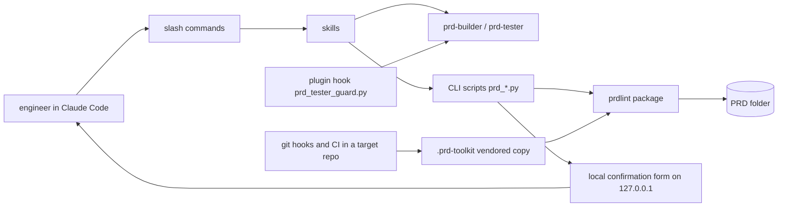

<!-- Format: references/prd-format.md, "prd.md sections". -->
<!-- The first approval goes through the prd-toolkit:authoring-prds skill (phase 7 gates); every later change and approval goes through prd-toolkit:changing-prds (step 5). -->

# prd-toolkit

## 1. Metadata & stack

- Language: Python 3.11 or later. Each CLI script (`prd-toolkit/scripts/prd_*.py`) is a uv script with an inline dependency header, run as `uv run --script <script>`, or through the launcher `prd-toolkit/scripts/prd` as `prd <command>` (the script's name without `prd_` and `.py`, `_` written `-`), which runs every script in one uv environment made from `scripts/requirements.txt`.
- Framework: a Claude Code plugin (skills, agents, slash commands, a plugin hook) in the `prdanvil` marketplace; script libraries pyyaml, sqlglot, openapi-spec-validator and markdown-it-py; pytest for the tests.
- Database: none.
- Hosting: the plugin is installed from the `prdanvil` marketplace into each user's Claude Code; a target repository runs a vendored copy of the scripts under `.prd-toolkit/` from its git hooks and CI, through the vendored launcher `.prd-toolkit/prd`.
- Repository: https://github.com/PRDAnvil/prd-toolkit, folder `prd-toolkit/`. This PRD covers `prd-toolkit/`, and from the release area the repository root's `prdanvil` marketplace file (`.claude-plugin/marketplace.json`) and root README; the root also holds the MIT LICENSE and this PRD. Until 2026-11-10 the toolkit lived in `ihistand/claude-plugins`; its history moved here with it.
- Not used: a network service, a database, a published Python package (target repositories run the vendored copy).
- Packaging: no build backend (`prd-toolkit/pyproject.toml` has `[tool.uv] package = false` and serves only the tests); the layout is `prd-toolkit/` with `scripts/` (the CLI scripts and the `prdlint` package), `skills/`, `agents/`, `commands/`, `hooks/`, `templates/` and `references/`; the entry points are the launcher `prd-toolkit/scripts/prd` (`prd <command>`) and the CLI scripts behind it, each of which also runs as `uv run --script prd-toolkit/scripts/prd_<name>.py`; the install command is `/plugin install prd-toolkit@prdanvil` after `/plugin marketplace add PRDAnvil/prd-toolkit`, and in a target repository `prd_hooks.py install docs/prd/<slug>` vendors the scripts.
- Not applicable: `contracts/openapi.yaml` — no HTTP API
- Not applicable: `contracts/schema.sql` — no database
- Not applicable: `contracts/events.md` — no events, jobs or queues
- Not applicable: `contracts/permissions.yaml` — no identities or roles
- Not applicable: `contracts/data-classification.yaml` — no stored personal data
- Not applicable: `contracts/dependencies/` — no third-party service is called; git and uv are tools on the runner (testing.md Harness), and the standards row runs the claude CLI through `npx`

## 2. Summary & goals

prd-toolkit keeps a living PRD folder in a repository and makes agents build, test and deploy
from it: a linter and trace checks for the folder, a black-box test agent, and skills that
author, adopt, change, build, deploy, handle errors in, publish and link PRDs.

Goals:

- Self-hosting: every area of the toolkit's own PRD (`adoption.md`) is `adopted`, with its characterization suite run in CI, before the plugin's version reaches 1.0.0.

Principles:

- The PRD is the authority: code implements what the PRD folder says and never defines behaviour it lacks.
- Spec-first, enforced: a behaviour change starts as a PRD change the owner approves, and the git hooks and CI refuse a commit that skips it.
- Black-box testable: every acceptance criterion has a test case a tester can write from the PRD alone, without reading the code.
- Error-Driven Development: every defect becomes an `errors.md` entry, and its fix starts from a test that fails first.
- The owner's word decides: approvals, error classes and human deploy steps are answered by the owner, never by an agent.
- Mechanical gates before judgement: lint, trace and the build checks run before any agent or person judges the work.
- The toolkit stays generic: it names no organization or platform; packs and wrapper plugins carry the specifics.

Getting started:

1. Install the plugin: `/plugin marketplace add PRDAnvil/prd-toolkit`, then `/plugin install prd-toolkit@prdanvil`.
2. Start a PRD with `/prd-toolkit:prd-new`, or bring an existing repository under one with `/prd-toolkit:prd-adopt`.
3. Install the hooks once per clone: `.prd-toolkit/prd hooks install docs/prd/<slug>`.
4. Change behaviour with `/prd-toolkit:prd-change`, then build it with `/prd-toolkit:prd-build`; report a bug with `/prd-toolkit:prd-error`.

Personas: an engineer working in a repository with Claude Code; the agents the toolkit
dispatches (`prd-builder`, `prd-tester`); a reviewer reading a published PRD page.

Out of scope: the target projects' own code.

## 3. Glossary

| Term | Meaning | Banned synonyms |
|---|---|---|
| PRD folder | `docs/prd/<slug>/` in a target repository: `prd.md` and the files the format reference names | spec folder |
| area | one feature file and its test-case file, bounded by the globs in its `adoption.md` row | none |
| requirement block | a `### UJ-nn`, `### FR-nnn` or `### NFR-nnn` heading and its field lines | story |
| finding | one line a check prints: `<file>:<line>: <rule>: <message>` | warning |
| rule | a named lint or trace check that produces findings | none |
| Boundary | the paths where the commit rule applies: the globs of the `adopted` rows | none |
| vendored copy | the scripts copied into a target repository's `.prd-toolkit/` by `prd_hooks.py install` | none |

## 4. Architecture

## 5. Standards registry

| Object (glob) | Linter command | Rules live in | Applies to | Decision |
|---|---|---|---|---|
| `prd-toolkit/**` | `npx -y @anthropic-ai/claude-code plugin validate ./prd-toolkit` `files: none` | Claude Code's plugin manifest schema | code | enforced |
| `.claude-plugin/marketplace.json` | `npx -y @anthropic-ai/claude-code plugin validate .` `files: none` | Claude Code's marketplace schema, S-02 | code | enforced |

## 6. Skills registry

| Object or activity | Skill | Decision |
|---|---|---|
| a change to `prd-toolkit/skills/**` | superpowers:writing-skills | required |
| a change to the plugin's layout or manifests | superpowers-developing-for-claude-code:developing-claude-code-plugins | required |
| any code change | superpowers:test-driven-development | required |
| a bug or a failing test | superpowers:systematic-debugging | required |
| a claim that work is done | superpowers:verification-before-completion | required |
| planning a change | superpowers:writing-plans | required |
| a review of a change | code-review | recommended |

## 7. Contract types

| Type | Files (glob) | Validator |
|---|---|---|
| errors | `contracts/errors.yaml` | built-in |
| config | `contracts/config.yaml` | built-in |
| fixtures | `contracts/fixtures/**` | built-in |
| cli | `contracts/cli.yaml` | `uv run --with pyyaml python3 -c "import sys,yaml; sys.exit(0 if isinstance(yaml.safe_load(open('contracts/cli.yaml')), dict) else 1)"` |

`cli` holds one top-level key per CLI script (`prd_lint`, `prd_trace`, …): its arguments, its
output lines and its exit codes. A test case targets a script as `cli:<key>`.

## 8. Adoption map

See adoption.md.

## 9. Versioning

- Breaking for the API: a removed or renamed script or option, a changed output-line format, or a changed exit-code meaning.
- Breaking for the schema: a change that makes a PRD folder that linted clean fail lint, or drops a field or file the format accepted.
- Breaking for events: Not applicable: no events.
- Compatibility window: an old form keeps working, with a finding that names its replacement, for at least one minor version of the plugin.
- Migration rule: every format change has an upgrade note in the README changelog; a breaking one also has a lint finding that says how to fix the PRD.

## 10. Design & UI

Not applicable: command-line scripts and Claude Code skills; the published PRD page is a generated file, not a product interface.

## 11. Requirement index

| ID | Title | Status | File | Since |
|---|---|---|---|---|
| UJ-01 | An engineer lints a PRD folder and fixes what it reports | live | features/lint-cli.md | 1.0.0 |
| FR-001 | Lint a PRD folder and print its findings | verified | features/lint-cli.md |  |
| FR-002 | Name each finding's file from the working directory | live | features/lint-cli.md | 1.0.0 |
| FR-003 | List the rules | verified | features/lint-cli.md |  |
| FR-004 | Reject a bad command line | verified | features/lint-cli.md |  |
| FR-005 | Refuse a folder without prd.md | verified | features/lint-cli.md |  |
| FR-006 | Report an internal error without a traceback | verified | features/lint-cli.md |  |
| FR-007 | Sample T-ids for the dry run | verified | features/lint-cli.md |  |
| FR-008 | Mark a CI run for the rules | live | features/lint-cli.md | 1.0.0 |
| FR-009 | Write UTF-8 in any locale | live | features/lint-cli.md | 1.0.0 |
| FR-010 | Name a missing dependency | verified | features/lint-cli.md |  |
| FR-011 | Load the test-case files | verified | features/lint-cli.md |  |
| FR-012 | Load the contract YAML files | verified | features/lint-cli.md |  |
| FR-013 | List the packs | verified | features/lint-cli.md |  |
| FR-014 | Print the lint result as a JSON document | verified | features/lint-cli.md |  |
| FR-015 | Leave the PRD folder's root README out of the lint | verified | features/lint-cli.md |  |
| FR-016 | Report a Levels Timeout that is not a whole number of seconds | verified | features/lint-cli.md |  |
| FR-017 | Report an Environments Branch that git refuses | verified | features/lint-cli.md |  |
| FR-018 | Check a runbook Check's matches pattern | verified | features/lint-cli.md |  |
| NFR-019 | A test run leaves no cached uv environments behind | verified | nfr.md |  |
| FR-020 | Check the prd.md frontmatter | verified | features/lint-structure.md |  |
| FR-021 | Report a PRD language with no table | verified | features/lint-structure.md |  |
| FR-022 | Require prd.md's fourteen sections in order | verified | features/lint-structure.md |  |
| FR-023 | Require the mandatory files and account for the optional ones | live | features/lint-structure.md | 6.2.0 |
| FR-024 | Check section 8 and adoption.md | verified | features/lint-structure.md |  |
| FR-025 | Check testing.md's Harness slots | verified | features/lint-structure.md |  |
| FR-026 | Read prose without code and errors.md quotations | verified | features/lint-structure.md |  |
| FR-027 | Report an unfilled placeholder | verified | features/lint-structure.md |  |
| FR-028 | Report a vague word without a number | verified | features/lint-structure.md |  |
| FR-029 | Report clarification markers left open once the PRD is in review | verified | features/lint-structure.md |  |
| FR-030 | Index every assumption marker | verified | features/lint-structure.md |  |
| FR-031 | Require no open question once the PRD is Approved | verified | features/lint-structure.md |  |
| FR-032 | Report a banned glossary synonym | verified | features/lint-structure.md |  |
| UJ-02 | A person or a program asks what a field or a lint finding means | verified | features/help.md |  |
| FR-033 | Print the index | verified | features/help.md |  |
| FR-034 | Print one entry or one rule as text | verified | features/help.md |  |
| FR-035 | Print the catalogue as one JSON document | verified | features/help.md |  |
| FR-036 | Refuse what it cannot answer | verified | features/help.md |  |
| FR-037 | The catalogue it reads, and what the shipped one covers | verified | features/help.md |  |
| FR-038 | Every lint rule carries a description | verified | features/help.md |  |
| FR-039 | A vendored copy answers the same | verified | features/help.md |  |
| UJ-03 | A person or a program asks what the PRD needs next | verified | features/status-next.md |  |
| FR-040 | The Next part comes first in the text report | verified | features/status-next.md |  |
| FR-041 | The Next items in the JSON document | verified | features/status-next.md |  |
| FR-042 | The order of the items, each listed once | verified | features/status-next.md |  |
| FR-043 | Broken: what must be fixed before anything else is trusted | verified | features/status-next.md |  |
| FR-044 | Waiting on you: the decisions only the owner can make | verified | features/status-next.md |  |
| FR-045 | Work: furthest along first | verified | features/status-next.md |  |
| FR-046 | Nothing waits | verified | features/status-next.md |  |
| FR-047 | A sentence ends with one full stop | verified | features/status-next.md |  |
| UJ-04 | An owner records where good practice comes from, and a builder is given the practices that apply | verified | features/practices.md |  |
| FR-048 | Read the sources and practices of practices.md | verified | features/practices.md |  |
| FR-049 | The lint rule practices | verified | features/practices.md |  |
| FR-050 | List the sources and practices | verified | features/practices.md |  |
| FR-051 | Print the record as one JSON document | verified | features/practices.md |  |
| FR-052 | Refuse what it cannot read | verified | features/practices.md |  |
| FR-053 | The launcher and a vendored copy answer the same | verified | features/practices.md |  |
| FR-054 | The next source and practice ID | verified | features/practices.md |  |
| FR-055 | The Practices part of the implement context pack | verified | features/practices.md |  |
| FR-056 | A pack's sources | verified | features/practices.md |  |
| UJ-05 | An owner with two adopted PRDs of one kind gets a pack from what they share | verified | features/pack-authoring.md |  |
| UJ-06 | An owner reading a card sees which area it is for and can open the thing it is about | verified | features/card-context.md |  |
| FR-057 | Compare two PRDs, as text | verified | features/pack-authoring.md |  |
| FR-058 | The comparison as JSON, and its refusals | verified | features/pack-authoring.md |  |
| FR-059 | Check a written pack against both PRDs | verified | features/pack-authoring.md |  |
| FR-060 | Lift a PRD onto the pack written from its own custom types | verified | features/pack-authoring.md |  |
| FR-061 | The launcher and a vendored copy answer the same | verified | features/pack-authoring.md |  |
| FR-062 | A gate's areas | verified | features/card-context.md |  |
| FR-063 | The URL: line of an error entry | verified | features/card-context.md |  |
| FR-064 | Write an entry's URL with prd error | verified | features/card-context.md |  |
| FR-065 | The url part of a Target: line | verified | features/card-context.md |  |
| FR-066 | A gate's URL | verified | features/card-context.md |  |
| FR-067 | Where the area and the URL show | verified | features/card-context.md |  |
| FR-068 | A standards row is never run on the vendored copy | verified | features/standards-run.md |  |
| FR-069 | The launcher runs on a system Python when uv finds one | verified | features/launcher.md |  |
| FR-070 | Install rewrites the toolkit's own hooks where core.hooksPath is set | verified | features/hook-shims.md |  |
| FR-071 | The inbox shows an error entry's card in the first worktree that holds it | verified | features/inbox-cards.md |  |
| FR-072 | The context pack prints an area's notes | verified | features/context-notes.md |  |
| FR-073 | The deploy and review eval scaffolds build their start states | verified | features/eval-scaffolds.md |  |
| FR-074 | The build check calls a changed file a tester's test only under a test root | verified | features/tester-paths.md |  |
| UJ-07 | Anyone with the repository sees whether the commit an entry names fixed it | verified | features/error-replay.md |  |
| FR-075 | The One test column of the Levels table | verified | features/error-replay.md |  |
| FR-076 | Replay an entry resolved with a T-id | verified | features/error-replay.md |  |
| FR-077 | Replay an entry resolved with a red run | verified | features/error-replay.md |  |
| FR-078 | What the replay prints and how it exits | verified | features/error-replay.md |  |
| FR-079 | The replay leaves nothing behind and writes nothing | verified | features/error-replay.md |  |
| FR-080 | Resolve a fix outside every adopted Boundary with a red run | verified | features/error-replay.md |  |
| FR-081 | Check a red run, and the older forms as before | verified | features/error-replay.md |  |
| FR-082 | Report a test that cites a T-id no live requirement owns | live | features/trace.md | 9.1.0 |
| FR-083 | Read citations under the test roots | live | features/trace.md | 9.1.0 |
| FR-084 | Report a T-id that no test cites | live | features/trace.md | 9.1.0 |
| FR-085 | Report a status that claims a test nothing cites | live | features/trace.md | 9.1.0 |
| FR-086 | Report known-failing cases and tags that disagree | live | features/trace.md | 9.1.0 |
| FR-087 | Print the trace findings and exit by them | live | features/trace.md | 9.1.0 |
| FR-088 | Print the trace result as a JSON document | live | features/trace.md | 9.1.0 |
| FR-089 | Refuse a trace it cannot run | live | features/trace.md | 9.1.0 |
| FR-090 | Check each commit of a range against the commit rule | verified | features/trace.md |  |
| FR-091 | Judge a commit message's Refs: trailers | live | features/trace.md | 9.1.0 |
| FR-092 | Judge a commit message's Change-set: trailers | live | features/trace.md | 9.1.0 |
| FR-093 | The commit-msg hook refuses a message the commit rule rejects | live | features/trace.md | 9.1.0 |
| FR-094 | The pre-commit hook runs each enforced standards row | live | features/trace.md | 9.1.0 |
| FR-095 | The git hook command refuses what it cannot run, and finds the work tree | live | features/trace.md | 9.1.0 |
| FR-096 | The hook shims skip a branch without the vendored copy | live | features/trace.md | 9.1.0 |
| FR-097 | Refuse a malformed hooks command line | live | features/hooks-install.md | 9.2.0 |
| FR-098 | Install writes the vendored copy of the toolkit's files | verified | features/hooks-install.md |  |
| FR-099 | Install vendors the PRD's packs and records where each came from | verified | features/hooks-install.md |  |
| FR-100 | Install adds the judge record and the review verdict to .gitignore | live | features/hooks-install.md | 9.2.0 |
| FR-101 | Install writes the hook shims where core.hooksPath is not set | approved | features/hooks-install.md |  |
| FR-102 | Install leaves a user's own hook alone and prints the line to add | live | features/hooks-install.md | 9.2.0 |
| FR-103 | The hook line runs the vendored launcher or skips a branch without it | live | features/hooks-install.md | 9.2.0 |
| FR-104 | Install refreshes the managed blocks and refuses a broken marker | live | features/hooks-install.md | 9.2.0 |
| FR-105 | Install names a stale CI file and never rewrites it | live | features/hooks-install.md | 9.2.0 |
| FR-106 | Install from the vendored copy writes the hooks only | live | features/hooks-install.md | 9.2.0 |
| FR-107 | Vendor refreshes .prd-toolkit/ and writes nothing else | verified | features/hooks-install.md |  |
| FR-108 | Check compares the vendored copy with the plugin | verified | features/hooks-install.md |  |
| FR-109 | Check reports a stale hook | live | features/hooks-install.md | 9.2.0 |
| FR-110 | Check reports a stale vendored pack | live | features/hooks-install.md | 9.2.0 |
| FR-111 | Check reports stale managed blocks and CI files | live | features/hooks-install.md | 9.2.0 |
| FR-112 | Uninstall removes only the toolkit's own hooks | verified | features/hooks-install.md |  |
| FR-113 | CI writes the include file and refuses to overwrite a different one | verified | features/hooks-install.md |  |
| FR-114 | The merge-gate jobs | verified | features/hooks-install.md |  |
| FR-115 | The manual drift and deploy-test jobs | live | features/hooks-install.md | 9.2.0 |
| FR-116 | The GitLab include file | verified | features/hooks-install.md |  |
| FR-117 | The GitHub workflow file | verified | features/hooks-install.md |  |
| FR-118 | The CI file names the secrets the manual jobs may need | live | features/hooks-install.md | 9.2.0 |
| FR-119 | The dispatcher runs one script by its command name | verified | features/hooks-install.md |  |
| FR-120 | The dispatcher's help and version | verified | features/hooks-install.md |  |
| FR-121 | Check the form of every ID | verified | features/lint-ids.md |  |
| FR-122 | Define each ID once | verified | features/lint-ids.md |  |
| FR-123 | Mark a removal in both the index and the block | live | features/lint-ids.md | 9.3.0 |
| FR-124 | Never cite a removed requirement or AC | live | features/lint-ids.md | 9.3.0 |
| FR-125 | Keep the section 11 index and the blocks in step | verified | features/lint-ids.md |  |
| FR-126 | Require a Source line on an as-built block | verified | features/lint-ids.md |  |
| FR-127 | Check errors.md entries against the blocks | verified | features/lint-ids.md |  |
| FR-128 | Require a feature file for an area past not started | live | features/lint-ids.md | 9.3.0 |
| FR-129 | Give every FR and NFR a live acceptance criterion | live | features/lint-ids.md | 9.3.0 |
| FR-130 | Write each live AC in an EARS pattern | live | features/lint-ids.md | 9.3.0 |
| FR-131 | Give every NFR a measurable bound | live | features/lint-ids.md | 9.3.0 |
| FR-132 | Check the Decision of each registry row | live | features/lint-registries.md | 9.4.0 |
| FR-133 | Check an enforced standard's linter command | verified | features/lint-registries.md |  |
| FR-134 | Require a required skill to be installed | live | features/lint-registries.md | 9.4.0 |
| FR-135 | Number the runbook's steps and give each its actor and environment | live | features/lint-registries.md | 9.4.0 |
| FR-136 | Give a human step Do and Check only | live | features/lint-registries.md | 9.4.0 |
| FR-137 | Check an agent step's Run, Check and Rollback | live | features/lint-registries.md | 9.4.0 |
| FR-138 | Check the form of a runbook tests step | live | features/lint-registries.md | 9.4.0 |
| FR-139 | Keep the Environments tables in step and mark production | live | features/lint-registries.md | 9.4.0 |
| FR-140 | Name a known environment on each step, Deployed row and Drift row | live | features/lint-registries.md | 9.4.0 |
| FR-141 | Put a human step at or just before each production environment's first step | live | features/lint-registries.md | 9.4.0 |
| FR-142 | Run only deploy-gate levels that have a Harness command | live | features/lint-registries.md | 9.4.0 |
| FR-143 | Check each Drift row's Check | approved | features/lint-registries.md |  |
| FR-144 | Number errors.md entries from E-001 upward | verified | features/lint-registries.md |  |
| FR-145 | Check an entry's Classification and Evidence | verified | features/lint-registries.md |  |
| FR-146 | Check an entry's Confirmed and Reopened lines | verified | features/lint-registries.md |  |
| FR-147 | Check Detected and Recurrence of on an entry with Confirmed | live | features/lint-registries.md | 9.4.0 |
| FR-148 | Describe each rule of the area | live | features/lint-registries.md | 9.4.0 |
| FR-149 | Require a test case for every live acceptance criterion | live | features/lint-testcases.md | 9.5.0 |
| FR-150 | Tie each Tests line to its test-cases file | verified | features/lint-testcases.md |  |
| FR-151 | Check the Gate column of the Levels table | live | features/lint-testcases.md | 9.5.0 |
| FR-152 | Report a build command that would collect deploy-gate tests | live | features/lint-testcases.md | 9.5.0 |
| FR-153 | Name a Levels row in each test case | live | features/lint-testcases.md | 9.5.0 |
| FR-154 | Require a case's scalar elements and a known target kind | live | features/lint-testcases.md | 9.5.0 |
| FR-155 | Require preconditions, input and expect in their forms | live | features/lint-testcases.md | 9.5.0 |
| FR-156 | Give an acceptance case its steps and sign-off | live | features/lint-testcases.md | 9.5.0 |
| FR-157 | Check a judged case's rubric, threshold, runs and output | approved | features/lint-testcases.md |  |
| FR-158 | Warn when a judged threshold below 1.0 needs every rubric item | live | features/lint-testcases.md | 9.5.0 |
| FR-159 | Point each case's ac at its own requirement | live | features/lint-testcases.md | 9.5.0 |
| FR-160 | Resolve each case's preconditions and input file | live | features/lint-testcases.md | 9.5.0 |
| FR-161 | Resolve each case's error codes, environment and identity | live | features/lint-testcases.md | 9.5.0 |
| FR-162 | Resolve each case's refs entries | verified | features/lint-testcases.md |  |
| FR-163 | Tie a known-failing case to an open entry and its symptom | live | features/lint-testcases.md | 9.5.0 |
| FR-164 | Resolve each case's target in the contracts | live | features/lint-testcases.md | 9.5.0 |
| FR-165 | Prove every denial with a test case | live | features/lint-testcases.md | 9.5.0 |
| FR-166 | Keep real-looking personal data out of classified fixture columns | live | features/lint-testcases.md | 9.5.0 |
| FR-167 | Keep real-looking personal data out of inline test input | live | features/lint-testcases.md | 9.5.0 |
| FR-168 | Tell real-looking personal data from synthetic | verified | features/lint-testcases.md |  |
| FR-169 | Describe each rule of the area | live | features/lint-testcases.md | 9.5.0 |
| FR-170 | Check each OpenAPI operation's PRD fields | live | features/lint-contracts.md | 9.6.0 |
| FR-171 | Require a content example on each OpenAPI response | live | features/lint-contracts.md | 9.6.0 |
| FR-172 | Require the asyncapi key of asyncapi.yaml | live | features/lint-contracts.md | 9.6.0 |
| FR-173 | Require the five field lines of each event in events.md | verified | features/lint-contracts.md |  |
| FR-174 | Check that schema.sql parses and describes every table and column | live | features/lint-contracts.md | 9.6.0 |
| FR-175 | Check each code of the error catalogue | live | features/lint-contracts.md | 9.6.0 |
| FR-176 | Check the roles and operations of permissions.yaml | verified | features/lint-contracts.md |  |
| FR-177 | Check the row rules of permissions.yaml | live | features/lint-contracts.md | 9.6.0 |
| FR-178 | Check the settings of config.yaml | live | features/lint-contracts.md | 9.6.0 |
| FR-179 | Check the tables and masking of data-classification.yaml | verified | features/lint-contracts.md |  |
| FR-180 | Check the shape of each dependency file | live | features/lint-contracts.md | 9.6.0 |
| FR-181 | Resolve each section 7 custom type to its files and validator | verified | features/lint-contracts.md |  |
| FR-182 | Run each custom type's validator and report its failure | verified | features/lint-contracts.md |  |
| FR-183 | Check each backticked table.column against schema.sql | verified | features/lint-contracts.md |  |
| FR-184 | Report a cited error code the catalogue lacks | verified | features/lint-contracts.md |  |
| FR-185 | Report a catalogued error code cited nowhere | verified | features/lint-contracts.md |  |
| FR-186 | Refuse a call that does not name exactly one check | live | features/build-check.md | 9.7.0 |
| FR-187 | Check the three packages before anything else | live | features/build-check.md | 9.7.0 |
| FR-188 | Stop on a PRD folder that cannot be loaded | live | features/build-check.md | 9.7.0 |
| FR-189 | Refuse a range that is not two commits | live | features/build-check.md | 9.7.0 |
| FR-190 | Fail a round that edits the PRD folder | live | features/build-check.md | 9.7.0 |
| FR-191 | Fail an edit of the vendored copy where the repository holds no one plugin | approved | features/build-check.md |  |
| FR-192 | Accept only an exact refresh of the vendored copy where the repository holds the plugin | approved | features/build-check.md |  |
| FR-193 | Hold SOURCES lines to the round's hunks | approved | features/build-check.md |  |
| FR-194 | Check a tester report's RESULTS block | live | features/build-check.md | 9.7.0 |
| FR-195 | List the dispatched T-ids whose test case changed after their test | live | features/build-check.md | 9.7.0 |
| FR-196 | Refuse --stale outside a git working tree | live | features/build-check.md | 9.7.0 |
| FR-197 | Stop a command that runs past 120 seconds | live | features/build-check.md | 9.7.0 |
| FR-198 | Stop when the report or SOURCES file cannot be read | live | features/build-check.md | 9.7.0 |
| FR-199 | The context command refuses a bad command line | live | features/context.md | 9.8.0 |
| FR-200 | The context command's interface number | live | features/context.md | 9.8.0 |
| FR-201 | Requests the context command refuses | live | features/context.md | 9.8.0 |
| FR-202 | The JSON error document of the context command | live | features/context.md | 9.8.0 |
| FR-203 | The repository pack | live | features/context.md | 9.8.0 |
| FR-204 | The Header part of an area pack | live | features/context.md | 9.8.0 |
| FR-205 | The Stack part | live | features/context.md | 9.8.0 |
| FR-206 | Which blocks an area pack selects | live | features/context.md | 9.8.0 |
| FR-207 | An errors.md entry in --req | live | features/context.md | 9.8.0 |
| FR-208 | The Requirements part | approved | features/context.md |  |
| FR-209 | The Glossary part | approved | features/context.md |  |
| FR-210 | The Cited part | live | features/context.md | 9.8.0 |
| FR-211 | The Upstream contracts part | live | features/context.md | 9.8.0 |
| FR-212 | The Known defects part | live | features/context.md | 9.8.0 |
| FR-213 | The Open questions part | live | features/context.md | 9.8.0 |
| FR-214 | The History part | live | features/context.md | 9.8.0 |
| FR-215 | The Code part of the implement pack | live | features/context.md | 9.8.0 |
| FR-216 | How a cited source line stands | live | features/context.md | 9.8.0 |
| FR-217 | The exit code counts the blocks asked for | live | features/context.md | 9.8.0 |
| FR-218 | The Levels part of the implement pack | live | features/context.md | 9.8.0 |
| FR-219 | The Harness defaults and Rubric conventions parts | live | features/context.md | 9.8.0 |
| FR-220 | The parts' order and the text pack | live | features/context.md | 9.8.0 |
| FR-221 | The JSON context document | live | features/context.md | 9.8.0 |
| FR-222 | The status command's arguments and refusals | live | features/status.md | 9.9.0 |
| FR-223 | The thirteen parts and their layout | live | features/status.md | 9.9.0 |
| FR-224 | The Header part | live | features/status.md | 9.9.0 |
| FR-225 | The Requirements part | live | features/status.md | 9.9.0 |
| FR-226 | The Areas part | live | features/status.md | 9.9.0 |
| FR-227 | The Adoption map part | live | features/status.md | 9.9.0 |
| FR-228 | The Not built and Not verified parts | live | features/status.md | 9.9.0 |
| FR-229 | The Open errors part | live | features/status.md | 9.9.0 |
| FR-230 | The Upstreams and Consumers parts | live | features/status.md | 9.9.0 |
| FR-231 | The Change sets part | live | features/status.md | 9.9.0 |
| FR-232 | The CI part | live | features/status.md | 9.9.0 |
| FR-233 | The Deployed part | live | features/status.md | 9.9.0 |
| FR-234 | The Matrix part | live | features/status.md | 9.9.0 |
| FR-235 | The CLAUDE.md block | approved | features/status.md |  |
| FR-236 | The block's change line | live | features/status.md | 9.9.0 |
| FR-237 | Where each block goes in its file | approved | features/status.md |  |
| FR-238 | What counts as a marker | live | features/status.md | 9.9.0 |
| FR-239 | Writing through a link, and keeping the mode | approved | features/status.md |  |
| FR-240 | The --check option | live | features/status.md | 9.9.0 |
| FR-241 | The PRD folder's README block | approved | features/status.md |  |
| FR-242 | The parent README block | approved | features/status.md |  |
| FR-243 | The parent README's install line | live | features/status.md | 9.9.0 |
| FR-244 | A marker in §2 | live | features/status.md | 9.9.0 |
| FR-245 | The block command's refusals | live | features/status.md | 9.9.0 |
| FR-246 | Which CLAUDE.md it writes | approved | features/status.md |  |
| FR-247 | §2's summary paragraph and first sentence | approved | features/status.md |  |
| FR-248 | §2's Principles and Getting started parts | live | features/status.md | 9.9.0 |
| FR-249 | The areas the PRD facts list | live | features/status.md | 9.9.0 |
| FR-250 | The other PRD facts | live | features/status.md | 9.9.0 |
| FR-251 | Reopen a confirmed entry | verified | features/error-reopen.md |  |
| FR-252 | Check a reopen | verified | features/error-reopen.md |  |
| FR-253 | Propose with an explanation, as unclassified, or as not a defect | verified | features/error-reopen.md |  |
| FR-254 | An error-class card explains the class and takes a question | verified | features/inbox-cards.md |  |
| FR-255 | The change command's exit codes and usage errors | live | features/change.md | 10.2.0 |
| FR-256 | The next free requirement, AC and T-id | live | features/change.md | 10.2.0 |
| FR-257 | The digest of a PRD folder | live | features/change.md | 10.2.0 |
| FR-258 | The proposed version bump and its output | live | features/change.md | 10.2.0 |
| FR-259 | How the bump classifies each changed item | live | features/change.md | 10.2.0 |
| FR-260 | Record a change in the version, §14 and §11 | approved | features/change.md |  |
| FR-261 | Move a PRD to a new version of its pack | live | features/change.md | 10.2.0 |
| FR-262 | The checks before an approval | verified | features/change.md |  |
| FR-263 | The approval commit | verified | features/change.md |  |
| FR-264 | A standards row says how its command takes files | verified | features/standards-run.md |  |
| FR-265 | Print the technical view | verified | features/trd.md |  |
| FR-266 | Map the areas and the requirements to the code | verified | features/trd.md |  |
| FR-267 | Keep the view out of the PRD | verified | features/trd.md |  |
| FR-268 | The marketplace manifest lists one plugin, prd-toolkit, from ./prd-toolkit | live | features/release.md | 13.1.0 |
| FR-269 | The plugin manifest names the plugin, its license and its skills and commands folders | live | features/release.md | 13.1.0 |
| FR-270 | The release version agrees in both manifests and the plugin README | live | features/release.md | 13.1.0 |
| FR-271 | One description in both manifests names every command of the plugin | verified | features/release.md |  |
| FR-272 | The rule count the manifests and READMEs name is the number of registered lint rules | live | features/release.md | 13.1.0 |
| FR-273 | The READMEs install and update the plugin by the manifests' names and describe its commands as they are | verified | features/release.md |  |
| FR-274 | The root README's prd shell function picks the vendored launcher or the newest installed plugin's | verified | features/release.md |  |
| FR-275 | The plugin ships the MIT license and a notice of the projects it adapts | live | features/release.md | 13.1.0 |
| FR-276 | Every relative link in the two READMEs names a file the repository tracks | verified | features/release.md |  |
| FR-277 | pyproject.toml and uv.lock define the test environment | live | features/release.md | 13.1.0 |
| FR-278 | Remind once per session when an edit lands where nothing is approved | verified | features/edit-hook.md |  |
| FR-279 | Report lint's new findings at Stop for the PRD folders the session edited | verified | features/edit-hook.md |  |
| FR-280 | The plugin wires the edit hook in both tiers | verified | features/edit-hook.md |  |
| FR-281 | The commands folder holds twelve command files of one shape | live | features/commands.md | 14.1.0 |
| FR-282 | The prd-status and prd-context commands share one Which script paragraph | live | features/commands.md | 14.1.0 |
| FR-283 | The prd-status command runs prd status once, unfiltered, and prints the report as it is | approved | features/commands.md |  |
| FR-284 | The prd-context command maps its arguments to prd context options and prints the pack as it is | approved | features/commands.md |  |
| FR-285 | The prd-new command hands the run to authoring-prds with the project slug | live | features/commands.md | 14.1.0 |
| FR-286 | The prd-adopt command hands the run to adopting-prds with the area | live | features/commands.md | 14.1.0 |
| FR-287 | The prd-change command runs changing-prds, or review mode on --review | live | features/commands.md | 14.1.0 |
| FR-288 | The prd-build command reads the build procedure first and maps its arguments to one --req | approved | features/commands.md |  |
| FR-289 | The prd-change-set command reads the change-set procedure first and enters a record by its Status | live | features/commands.md | 14.1.0 |
| FR-290 | The prd-deploy command reads the deploy procedure first and passes --until or a run id | live | features/commands.md | 14.1.0 |
| FR-291 | The prd-error command reads the error procedure first and enters an entry by its state | live | features/commands.md | 14.1.0 |
| FR-292 | The prd-publish command loads publishing-prds first and keeps the page out of the PRD folder and git | live | features/commands.md | 14.1.0 |
| FR-293 | The prd-practices command reads the practices procedure first and installs nothing before approval | live | features/commands.md | 14.1.0 |
| FR-294 | The prd-pack command reads the pack procedure first and takes two PRD folders | live | features/commands.md | 14.1.0 |

## 12. Assumptions index

| ID | Assumption | Status |
|---|---|---|

## 13. Open questions

None.

## 14. Changelog

| Version | Date | Change | IDs |
|---|---|---|---|
| 0.1.0 | 2026-11-03 | Draft started (adoption bootstrap) | none |
| 1.0.0 | 2026-11-03 | Approved; lint-cli area adopted; suite 29 pass, T-005.3 known-failing E-001, T-006.3 known-failing E-005, T-007.5 known-failing E-006, T-010.2 known-failing E-002, T-011.6 known-failing E-003, T-012.3 known-failing E-003, T-012.2 known-failing E-004; dry run T-004.1, T-007.1, T-007.5, T-011.1, T-011.2, 0 open questions, 0 dismissed by quote (an earlier dry run's 2 testing.md gaps were fixed) | UJ-01, FR-001, FR-002, FR-003, FR-004, FR-005, FR-006, FR-007, FR-008, FR-009, FR-010, FR-011, FR-012 |
| 1.0.1 | 2026-11-03 | §5 standards row runs `plugin validate` through `npx -y @anthropic-ai/claude-code`, so the generated CI job needs no claude CLI on the runner; §1 says so; no dry run (wording only) | none |
| 2.0.0 | 2026-11-03 | lint-cli for prd-toolkit 0.8.0: `warn` findings and an exit code that counts errors only, `--list-rules` with severities (a format change §9 calls breaking, accepted by the owner for 0.8.0), `--list-packs` (FR-013), and a one-line usage; the PRD_PLUGINS_FILE setting in contracts/config.yaml; testing.md defines the output keys, `runs`/`each_run` and in-process calls; dry run T-001.4, T-001.5, T-003.1, T-004.1, T-004.3, T-013.1, T-013.2, 0 open questions, 0 dismissed by quote (three earlier dry runs' 10 gaps fixed) | FR-001, AC-001.2, AC-001.4, AC-001.5, T-001.4, T-001.5, FR-003, AC-003.1, T-003.1, FR-004, AC-004.1, AC-004.3, T-004.1, T-004.3, FR-013, AC-013.1, AC-013.2, T-013.1, T-013.2 |
| 2.1.0 | 2026-11-03 | lint-cli FR-013: the vendored copy's `--list-packs` (its vendored packs with the sources pack-sources.json records, and its stderr note), as 0.8.0 ships it; AC-013.1 and AC-013.2 name the plugin's copy; testing.md gains the repo/vendored fixture and the stderr keys; dry run T-013.3, T-013.4, 0 open questions, 1 dismissed by quote (two earlier dry runs' 7 gaps fixed) | FR-013, AC-013.1, AC-013.2, AC-013.3, T-013.3, T-013.4 |
| 3.0.0 | 2026-11-03 | lint-cli for prd-toolkit 0.8.1: `--json` prints one `lint` JSON document (FR-014) and `--interface` prints the interface number; FR-001's line output is scoped to a run without `--json`; the one-line usage names both options (AC-004.1, a changed usage line T-004.1 and T-004.3 assert, so major); `prdlint/interface.py` joins the Boundary; testing.md gains the `stdout_json` keys; dry run T-004.1, T-004.3, T-014.1, T-014.2, T-014.3, T-014.4, T-014.5, T-014.6, T-014.7, 0 open questions, 1 dismissed by quote (an earlier dry run's 2 gaps fixed) | FR-001, AC-001.1, AC-001.2, AC-001.4, AC-001.5, FR-004, AC-004.1, T-004.1, T-004.3, FR-014, AC-014.1, AC-014.2, AC-014.3, AC-014.4, AC-014.5, AC-014.6, T-014.1, T-014.2, T-014.3, T-014.4, T-014.5, T-014.6, T-014.7 |
| 4.0.0 | 2026-11-04 | lint-cli FR-014: `--interface` wins over an unsupported `--json=<N>` (AC-014.4 no longer applies when `--interface` is given, so major; AC-014.5 says it), a gap the 0.8.1 build found; cli.yaml says it; dry run T-014.4, T-014.5, T-014.8, 0 open questions, 0 dismissed by quote | FR-014, AC-014.4, AC-014.5, T-014.8 |
| 5.0.0 | 2026-11-07 | lint-cli FR-006 for E-007: AC-006.3 widened so an entry named `<name>.yaml` in test-cases/ or under contracts/ outside contracts/fixtures/ that is not a regular file is a sufficiency finding at line 0 (`a .yaml entry that is not a file`), not an internal error (an input that exited 2 now exits 1, so major); regression tests T-006.4 and T-006.5 known-failing E-007; testing.md Tools on the runner names macOS or Linux with symbolic links and the pyproject.toml environment the Levels commands run in, two gaps the dry runs found; the STALE Source: line of FR-006 refreshed; dry run T-006.4, T-006.5, 0 open questions, 2 dismissed by quote (three earlier dry runs' 3 gaps fixed) | FR-006, AC-006.3, T-006.4, T-006.5 |
| 5.1.0 | 2026-11-07 | lint-cli FR-015 for prd-toolkit 0.8.4: lint reports no finding in the PRD folder's root README.md, which prd_block.py generates, and reads every other README.md as before (T-015.1, T-015.2, with the new fixture lint-cli/readme_markers in testing.md); §2 gains its Principles and Getting started parts; adoption.md maps 13 unmapped scripts in four not started rows (gates, change, judge, packs) and adds the 0.8.4 overview and README templates to the status row; dry run T-015.1, T-015.2, 0 open questions, 0 dismissed by quote (an earlier dry run's 1 gap fixed, 1 question dismissed by quote) | FR-015 |
| 5.2.0 | 2026-11-08 | lint-cli FR-016, FR-017, FR-018 for prd-toolkit 0.8.5: lint reports a testing.md Levels Timeout cell that is not a whole number of seconds of at least 1 (runbook-tests), an operations.md Environments Branch cell that git check-ref-format --branch refuses (runbook-env), and a runbook Check whose matches pattern does not compile or that holds both prints and matches (runbook-steps), with T-016.1, T-017.1, T-018.1 and T-018.2 on the fixture changes M2 to M5; testing.md runs the unit and integration levels with -n auto (pytest-xdist), a patch item; dry run T-016.1, T-017.1, T-018.1, T-018.2, 0 open questions, 0 dismissed by quote | FR-016, FR-017, FR-018 |
| 6.0.0 | 2026-11-09 | lint-cli FR-010 for prd-toolkit 0.8.5: prd_publish.py's dependency header gains the pinned diagram renderer mermaidx==0.11.3, so by the unchanged AC-010.2 its missing-package hint ends pip install pyyaml sqlglot openapi-spec-validator markdown-it-py mermaidx; T-010.2's expected stderr and note gain mermaidx (a changed expect, so major) and FR-010's Edge cases line names both added packages; adoption.md's publish row maps the new prdlint/diagrams.py, a patch item; dry run T-010.2, 0 open questions, 3 dismissed by quote | FR-010, T-010.2 |
| 6.1.0 | 2026-11-09 | NFR-019: a test run leaves no cached uv environments behind (test cache per worktree, E-008); dry run T-019.1, T-019.2, 0 open questions, 0 dismissed by quote | NFR-019, AC-019.1, AC-019.2, T-019.1, T-019.2 |
| 6.2.0 | 2026-11-10 | lint-structure area adopted (prdlint/rules/structure.py); suite 85 pass, T-020.14 known-failing E-012, T-022.4 known-failing E-009, T-022.5 known-failing E-014, T-024.7 known-failing E-016, T-025.9 known-failing E-013, T-025.10 known-failing E-014, T-027.9 known-failing E-011, T-028.7 known-failing E-010, T-028.8 known-failing E-010, T-029.11 known-failing E-011, T-030.10 known-failing E-011, T-031.3 known-failing E-015, T-032.5 known-failing E-011; testing.md gains the lint-structure/texts fixture and the stdout_not_contains and stdout_count_of_line keys; contracts/cli.yaml gains prd_lint.structure_findings; E-009 to E-016 recorded open; dry run T-020.14, T-022.4, T-022.5, T-024.7, T-025.9, T-025.10, T-027.9, T-028.7, T-028.8, T-029.11, T-030.10, T-031.3, T-032.5, 0 open questions, 0 dismissed by quote | FR-001, FR-002, FR-003, FR-004, FR-007, FR-008, FR-009, FR-013, FR-014, FR-020, FR-021, FR-022, FR-023, FR-024, FR-025, FR-026, FR-027, FR-028, FR-029, FR-030, FR-031, FR-032, AC-020.1, AC-020.2, AC-020.3, AC-020.4, AC-020.5, AC-020.6, AC-021.1, AC-021.2, AC-022.1, AC-022.2, AC-022.3, AC-022.4, AC-023.1, AC-023.2, AC-023.3, AC-023.4, AC-024.1, AC-024.2, AC-024.3, AC-024.4, AC-024.5, AC-024.6, AC-024.7, AC-024.8, AC-024.9, AC-025.1, AC-025.2, AC-025.3, AC-025.4, AC-025.5, AC-025.6, AC-025.7, AC-025.8, AC-025.9, AC-026.1, AC-026.2, AC-026.3, AC-027.1, AC-027.2, AC-027.3, AC-027.4, AC-027.5, AC-028.1, AC-028.2, AC-028.3, AC-028.4, AC-029.1, AC-029.2, AC-029.3, AC-029.4, AC-029.5, AC-030.1, AC-030.2, AC-030.3, AC-030.4, AC-030.5, AC-031.1, AC-031.2, AC-031.3, AC-032.1, AC-032.2, AC-032.3, AC-032.4, T-020.1, T-020.2, T-020.3, T-020.4, T-020.5, T-020.6, T-020.7, T-020.8, T-020.9, T-020.10, T-020.11, T-020.12, T-020.13, T-020.14, T-021.1, T-021.2, T-022.1, T-022.2, T-022.3, T-022.4, T-022.5, T-023.1, T-023.2, T-023.3, T-023.4, T-023.5, T-023.6, T-023.7, T-023.8, T-024.1, T-024.2, T-024.3, T-024.4, T-024.5, T-024.6, T-024.7, T-024.8, T-024.9, T-025.1, T-025.2, T-025.3, T-025.4, T-025.5, T-025.6, T-025.7, T-025.8, T-025.9, T-025.10, T-026.1, T-026.2, T-026.3, T-026.4, T-027.1, T-027.2, T-027.3, T-027.4, T-027.5, T-027.6, T-027.7, T-027.8, T-027.9, T-028.1, T-028.2, T-028.3, T-028.4, T-028.5, T-028.6, T-028.7, T-028.8, T-029.1, T-029.2, T-029.3, T-029.4, T-029.5, T-029.6, T-029.7, T-029.8, T-029.9, T-029.10, T-029.11, T-030.1, T-030.2, T-030.3, T-030.4, T-030.5, T-030.6, T-030.7, T-030.8, T-030.9, T-030.10, T-031.1, T-031.2, T-031.3, T-032.1, T-032.2, T-032.3, T-032.4, T-032.5 |
| 6.2.1 | 2026-11-10 | the toolkit moves to github.com/PRDAnvil/prd-toolkit and the prdanvil marketplace: section 1 Framework, Hosting, Repository and Packaging, section 2 Getting started, the operations.md production Environment and runbook steps 2 and 3, and the testing.md production row name the new home; the release area Boundary adds prd-toolkit/LICENSE; no dry run (wording only) | - |
| 6.2.2 | 2026-11-10 | §2 Getting started names the commands in full, /prd-toolkit:prd-new and the rest, as current Claude Code lists them; no dry run (wording only) | - |
| 6.2.3 | 2026-11-14 | for prd-toolkit 0.8.8: section 1 names the launcher prd-toolkit/scripts/prd beside the CLI scripts, and the vendored launcher the hooks and CI run; section 2 Getting started installs the hooks with .prd-toolkit/prd hooks install, and its Out of scope line drops the other plugins and the web/ docs site, which the repository has not held since the move; adoption.md maps the launcher, prd_dispatch.py and requirements.txt in trace-and-hooks and requirements-publish.txt in publish; no dry run (wording only) | - |
| 6.3.0 | 2026-11-14 | a new area help for prd-toolkit 0.8.9, written before its code: prd_help.py (prd help) prints a catalogue of every field of the PRD grammar and every lint rule as an index, one entry (--key), one rule (--rule) or one JSON document (--json), refuses an unknown key or rule, a usage error and a catalogue it cannot use with exit 2, reads the setting PRD_HELP_FILE, and answers the same from a vendored copy; every lint rule carries a description that lint never prints (FR-003 Edge cases); contracts/cli.yaml gains prd_help, contracts/config.yaml PRD_HELP_FILE, testing.md the fixture help/catalogue and the assertion keys stdout_json_at, stdout_json_keys_at and relations, adoption.md the adopted row help; dry run T-034.3, T-035.3, 0 open questions, 1 dismissed by quote (two earlier dry runs over ten T-ids: 4 gaps fixed) | UJ-02, FR-003, FR-033, FR-034, FR-035, FR-036, FR-037, FR-038, FR-039, AC-033.1, AC-034.1, AC-034.2, AC-035.1, AC-035.2, AC-035.3, AC-035.4, AC-036.1, AC-036.2, AC-036.3, AC-036.4, AC-036.5, AC-037.1, AC-037.2, AC-037.3, AC-038.1, AC-038.2, AC-038.3, AC-039.1, T-033.1, T-034.1, T-034.2, T-034.3, T-035.1, T-035.2, T-035.3, T-035.4, T-036.1, T-036.2, T-036.3, T-036.4, T-036.5, T-037.1, T-037.2, T-037.3, T-038.1, T-038.2, T-038.3, T-039.1 |
| 6.4.0 | 2026-11-15 | a new area status-next for prd-toolkit 0.8.10, written before its code: prd status starts with a part Next, the ordered list of what the PRD needs (lint and trace findings, stopped deploy runs, open errors, gates, questions, a draft, then deploy, verify, build and adopt work, or idle when nothing waits), each item one sentence with the command that does it, in the text report and first in the --json items with the keys part, id, text, kind, ids, area, command and waits_on; contracts/cli.yaml gains prd_status, testing.md the fixtures status-next/base, status-next/empty and status-next/files, a Setup steps section with the git variables its runs drop, the assertion keys next_part_lines and next_items_json and the rule that a test builds a citation-shaped text from parts, adoption.md the adopted row status-next; dry run T-042.2, T-043.3, T-043.1, T-043.4, T-043.7, T-044.3, T-044.4, T-045.1, T-047.1, 0 open questions, 1 dismissed by quote (two earlier dry runs over sixteen T-ids: 3 gaps fixed) | UJ-03, FR-040, FR-041, FR-042, FR-043, FR-044, FR-045, FR-046, FR-047, AC-040.1, AC-040.2, AC-040.3, AC-041.1, AC-041.2, AC-042.1, AC-042.2, AC-042.3, AC-043.1, AC-043.2, AC-043.3, AC-043.4, AC-044.1, AC-044.2, AC-044.3, AC-045.1, AC-045.2, AC-045.3, AC-045.4, AC-046.1, AC-046.2, AC-047.1, T-040.1, T-040.2, T-040.3, T-041.1, T-041.2, T-042.1, T-042.2, T-042.3, T-043.1, T-043.2, T-043.3, T-043.4, T-043.5, T-043.6, T-043.7, T-043.8, T-044.1, T-044.2, T-044.3, T-044.4, T-044.5, T-044.6, T-045.1, T-045.2, T-045.3, T-045.4, T-046.1, T-046.2, T-047.1 |
| 7.0.0 | 2026-11-15 | a new area practices for prd-toolkit 0.8.11, written before its code: practices.md in a PRD folder holds a Sources table and a Practices table (FR-048), the lint rule practices (the 41st) checks their IDs, Decisions, dates, Applies to, globs and the S-nn a section 5 row names (FR-049), prd practices lists them as text, by --paths or as one JSON document and refuses what it cannot read (FR-050 to FR-053), prd change ids next takes S and P (FR-054), the implement context pack of a PRD that holds practices.md gains a Practices part and a PRD without the file gets the pack it gets today (FR-055), and a pack manifest takes the optional sources list (FR-056); lint-cli T-003.1 and help T-033.1 gain the line for the rule practices (a changed expect, so major) and FR-003 Edge cases names it, help AC-037.4 and T-037.4 add the catalogue entries kind.S, kind.P, file.practices, table.sources and table.practices; contracts/cli.yaml gains prd_practices (with the finding messages of the rule practices), prd_change, prd_context and the five prd_help keys, testing.md the fixtures practices/repo and practices/texts, the practices Setup steps and the assertion keys pack_part_titles and pack_part_lines, adoption.md the adopted row practices; dry run T-055.6, T-049.5, T-049.10, T-049.12, T-051.4, T-052.2, T-052.4, T-053.2, T-054.2, T-054.4, T-055.4, T-056.2, 0 open questions, 1 dismissed by quote (three earlier dry runs over thirty-six T-ids: 3 gaps fixed) | UJ-04, FR-003, FR-033, FR-034, FR-035, FR-036, FR-037, FR-048, FR-049, FR-050, FR-051, FR-052, FR-053, FR-054, FR-055, FR-056, AC-037.4, AC-048.1, AC-048.2, AC-048.3, AC-049.1, AC-049.2, AC-049.3, AC-049.4, AC-049.5, AC-049.6, AC-049.7, AC-049.8, AC-049.9, AC-049.10, AC-050.1, AC-050.2, AC-051.1, AC-051.2, AC-051.3, AC-051.4, AC-052.1, AC-052.2, AC-052.3, AC-052.4, AC-052.5, AC-053.1, AC-053.2, AC-054.1, AC-054.2, AC-054.3, AC-055.1, AC-055.2, AC-055.3, AC-055.4, AC-055.5, AC-056.1, AC-056.2, AC-056.3, T-003.1, T-033.1, T-037.4, T-048.1, T-048.2, T-048.3, T-049.1, T-049.2, T-049.3, T-049.4, T-049.5, T-049.6, T-049.7, T-049.8, T-049.9, T-049.10, T-049.11, T-049.12, T-049.13, T-049.14, T-050.1, T-050.2, T-050.3, T-051.1, T-051.2, T-051.3, T-051.4, T-052.1, T-052.2, T-052.3, T-052.4, T-052.5, T-053.1, T-053.2, T-054.1, T-054.2, T-054.3, T-054.4, T-054.5, T-055.1, T-055.2, T-055.3, T-055.4, T-055.5, T-055.6, T-056.1, T-056.2, T-056.3 |
| 7.1.0 | 2026-11-15 | a pack written from two adopted PRDs (prd pack compare, prd pack check, prd change pack --lift) and the areas and a URL of every gate in prd gates list --json and the inbox card; standards rows are not run on the vendored copy, for E-025; dry run T-068.7, T-068.5, T-068.6, 0 open questions, 0 dismissed by quote (nine earlier dry runs over all 63 non-unit T-ids: 21 gaps fixed) | UJ-05, UJ-06, FR-057, FR-058, FR-059, FR-060, FR-061, FR-062, FR-063, FR-064, FR-065, FR-066, FR-067, FR-068, AC-057.1, AC-057.2, AC-057.3, AC-057.4, AC-057.5, AC-057.6, AC-057.7, AC-057.8, AC-058.1, AC-058.2, AC-058.3, AC-058.4, AC-059.1, AC-059.2, AC-059.3, AC-059.4, AC-059.5, AC-059.6, AC-060.1, AC-060.2, AC-060.3, AC-060.4, AC-060.5, AC-060.6, AC-060.7, AC-060.8, AC-061.1, AC-061.2, AC-062.1, AC-062.2, AC-062.3, AC-062.4, AC-063.1, AC-063.2, AC-063.3, AC-064.1, AC-064.2, AC-064.3, AC-064.4, AC-065.1, AC-065.2, AC-065.3, AC-066.1, AC-066.2, AC-066.3, AC-066.4, AC-067.1, AC-067.2, AC-067.3, AC-067.4, AC-067.5, AC-067.6, AC-068.1, AC-068.2, AC-068.3, AC-068.4, AC-068.5, T-057.1, T-057.2, T-057.3, T-057.4, T-057.5, T-057.6, T-057.7, T-057.8, T-058.1, T-058.2, T-058.3, T-058.4, T-058.5, T-059.1, T-059.2, T-059.3, T-059.4, T-059.5, T-059.6, T-059.7, T-060.1, T-060.2, T-060.3, T-060.4, T-060.5, T-060.6, T-060.7, T-060.8, T-060.9, T-060.10, T-061.1, T-061.2, T-062.1, T-062.2, T-062.3, T-062.4, T-062.5, T-063.1, T-063.2, T-063.3, T-064.1, T-064.2, T-064.3, T-064.4, T-065.1, T-065.2, T-065.3, T-066.1, T-066.2, T-066.3, T-066.4, T-067.1, T-067.2, T-067.3, T-067.4, T-067.5, T-067.6, T-068.1, T-068.2, T-068.3, T-068.4, T-068.5, T-068.6, T-068.7 |
| 7.2.0 | 2026-11-16 | pack-authoring gaps closed: the linter of a Linter cell with no backticked span, the Pack: line of a section 1 with no bullet, the line numbers of findings after a lift, the literal last word of the more-than-one-source refusal; dry run T-057.9, T-060.11, T-060.12, 0 open questions, 1 dismissed by quote | FR-057, FR-060, AC-057.6, AC-060.1, AC-060.7, AC-060.8, T-057.9, T-060.11, T-060.12 |
| 7.3.0 | 2026-11-16 | fixes for E-026 and E-027: the approval of a lift commits the vendored pack, and the check proves each validator runs from the pack folder; dry run T-059.8, T-060.13, 0 open questions, 0 dismissed by quote (four earlier dry runs: 7 gaps fixed, 1 dismissed by quote) | FR-057, FR-058, FR-059, FR-060, FR-061, AC-059.7, AC-060.9, T-059.8, T-060.13 |
| 8.0.0 | 2026-11-17 | fixes for E-020, E-021 and E-030: prd help refuses a catalogue file that is there and cannot be read with the reason cannot read (AC-036.3); a section 13 question is taken without the white space at its start and end, so a line ending in spaces gets no second full stop (AC-044.2, a changed result, so major); a lift refuses a pack that declares no contract type (AC-060.10, checked before AC-060.4), and AC-060.7 allows, beside the findings lint printed before a lift, the platform-word findings of the pack vocabulary; contracts/cli.yaml gains the refusal no_types, testing.md the steps NQ4, KE and KX; dry run T-036.6, T-044.7, T-060.14, T-060.15, 0 open questions, 1 dismissed by quote | FR-036, FR-044, FR-060, AC-036.3, AC-044.2, AC-060.1, AC-060.5, AC-060.7, AC-060.10, T-036.6, T-044.7, T-060.14, T-060.15 |
| 8.1.0 | 2026-11-17 | four new adopted areas written before their code, for E-022, E-023, E-024 and E-028: launcher (the prd launcher asks uv python find --system for a Python 3.11 or later and runs on the path it prints, else on >=3.11 as before), hook-shims (prd hooks install rewrites the toolkit own hooks where core.hooksPath is set, so check no longer calls them stale), inbox-cards (the decision inbox shows an error-class card once, in the first worktree group whose PRD folder holds the same entry, and its answer commits there alone) and context-notes (prd context --area prints the text a features file gives before its first block as a part Area notes before Requirements); contracts/cli.yaml gains prd_launcher and new keys of prd_hooks, prd_gates and prd_context, testing.md the fixtures launcher/texts, hook-shims/texts and context-notes/texts, Setup steps for the four areas and a cwd per run, adoption.md the four rows, the launcher moving out of trace-and-hooks; dry run T-069.1, T-069.2, T-069.3, T-070.1, T-070.2, T-070.3, T-071.1, T-071.2, T-071.3, T-071.4, T-071.5, T-072.1, T-072.2, 0 open questions, 1 dismissed by quote (four earlier rounds over the same T-ids: 16 gaps fixed) | FR-055, FR-062, FR-066, FR-067, FR-068, FR-069, FR-070, FR-071, FR-072, AC-069.1, AC-069.2, AC-070.1, AC-070.2, AC-070.3, AC-071.1, AC-071.2, AC-071.3, AC-072.1, AC-072.2, T-069.1, T-069.2, T-069.3, T-070.1, T-070.2, T-070.3, T-071.1, T-071.2, T-071.3, T-071.4, T-071.5, T-072.1, T-072.2 |
| 8.2.0 | 2026-11-18 | a new adopted area written before its code, for E-019: eval-scaffolds (deploy_repo.py commits every file install left untracked, in one dated commit after Vendor the PRD toolkit, so the six deploy scaffolds end with a clean tree; the review-edits-nothing scaffold expects the index row record writes, with an empty Since); contracts/cli.yaml gains eval_scaffolds; testing.md Tools on the runner names bash and the network need of T-073.1 to T-073.3; dry run T-073.1, T-073.2, T-073.3, T-073.4, 0 open questions, 0 dismissed by quote (two earlier rounds over the same T-ids: 7 gaps fixed) | FR-073, AC-073.1, AC-073.2, AC-073.3, T-073.1, T-073.2, T-073.3, T-073.4 |
| 8.2.1 | 2026-11-18 | eval-scaffolds, found by the FR-073 build for E-019: the area text names a third file the build edits, error_repo.py, which builds on deploy_repo.py and makes its CLAUDE.md commit only when prd_block.py left something to commit; no AC, test case or contract changes; no dry run (no new or revised T-id) | FR-073 |
| 8.3.0 | 2026-11-18 | a new adopted area written before its code, for E-031: tester-paths (the build check calls a changed file a tester test only when it lies under a test root of testing.md, tests when it names none, so a file outside the roots that holds a citation text can be changed by a build); contracts/cli.yaml gains prd_build_check, testing.md the tester-paths Setup steps, adoption.md the row; dry run T-074.1, T-074.2, T-074.3, T-074.4, T-074.5, 0 open questions, 0 dismissed by quote (three rounds: 3 gaps in the Setup steps text fixed after the first two, the third over T-074.2 and T-074.5 clean) | FR-074, AC-074.1, AC-074.2, T-074.1, T-074.2, T-074.3, T-074.4, T-074.5 |
| 8.3.1 | 2026-11-18 | test case corrected for E-019: T-073.3 reads the commit dates in git raw form (seconds and offset), which every git version prints alike, where the ISO form it used prints offset zero as +00:00 or as Z by version; AC-073.2 and the code are unchanged; FR-073 returns to approved; dry run T-073.3, 0 open questions, 0 dismissed by quote | FR-073, T-073.3 |
| 8.4.0 | 2026-11-20 | a new adopted area written before its code, for prd-toolkit 0.8.14: error-replay (prd error replay runs an entry test on the commit before its fix, where it must fail, and on the fix, where it must pass, each run in a temporary git worktree it removes, and prints that the proof holds, a skip with its reason, or each finding; a fourth Resolution form, a fix with a red run in place of a T-id for code no adopted area covers, which prd error resolve --red-run writes only when its replay holds and prd error check reads; the optional One test column of testing.md Levels, the command that runs one test, which the rule runbook-tests checks); contracts/cli.yaml gains the replay, resolve --red-run and check items under prd_error, testing.md the fixture error-replay/files, the error-replay Setup steps and a Waits exception for the interrupt case, adoption.md the row; format: One test column (prd-toolkit 0.8.14); dry run T-075.1, T-075.2, T-075.3, T-075.4, T-075.5, T-076.1, T-076.2, T-076.3, T-076.4, T-076.5, T-076.6, T-076.7, T-076.8, T-076.9, T-077.1, T-077.2, T-077.3, T-077.4, T-077.5, T-078.1, T-078.2, T-078.3, T-078.4, T-078.5, T-078.6, T-078.7, T-078.8, T-078.9, T-078.10, T-078.11, T-078.12, T-078.13, T-078.14, T-078.15, T-078.16, T-078.17, T-078.18, T-078.19, T-078.20, T-078.21, T-078.22, T-079.1, T-079.2, T-079.3, T-079.4, T-079.5, T-080.1, T-080.2, T-080.3, T-080.4, T-080.5, T-080.6, T-080.7, T-080.8, T-080.9, T-080.10, T-080.11, T-080.12, T-080.13, T-080.14, T-080.15, T-081.1, T-081.2, T-081.3, T-081.4, T-081.5, T-081.6, T-081.7, T-081.8, T-081.9, T-081.10, T-081.11, T-081.12, T-081.13, 0 open questions, 0 dismissed by quote (two rounds: 4 gaps in testing.md, AC-081.3, AC-081.4 and two cases fixed after the first, over all 74; the second, over the 13 T-ids they touch, clean) | UJ-07, FR-063, FR-064, FR-065, FR-075, FR-076, FR-077, FR-078, FR-079, FR-080, FR-081, AC-075.1, AC-075.2, AC-075.3, AC-075.4, AC-076.1, AC-076.2, AC-076.3, AC-076.4, AC-076.5, AC-077.1, AC-077.2, AC-077.3, AC-078.1, AC-078.2, AC-078.3, AC-078.4, AC-078.5, AC-078.6, AC-078.7, AC-078.8, AC-078.9, AC-078.10, AC-078.11, AC-078.12, AC-078.13, AC-079.1, AC-079.2, AC-079.3, AC-079.4, AC-079.5, AC-080.1, AC-080.2, AC-080.3, AC-080.4, AC-080.5, AC-080.6, AC-080.7, AC-080.8, AC-080.9, AC-080.10, AC-081.1, AC-081.2, AC-081.3, AC-081.4, T-075.1, T-075.2, T-075.3, T-075.4, T-075.5, T-076.1, T-076.2, T-076.3, T-076.4, T-076.5, T-076.6, T-076.7, T-076.8, T-076.9, T-077.1, T-077.2, T-077.3, T-077.4, T-077.5, T-078.1, T-078.2, T-078.3, T-078.4, T-078.5, T-078.6, T-078.7, T-078.8, T-078.9, T-078.10, T-078.11, T-078.12, T-078.13, T-078.14, T-078.15, T-078.16, T-078.17, T-078.18, T-078.19, T-078.20, T-078.21, T-078.22, T-079.1, T-079.2, T-079.3, T-079.4, T-079.5, T-080.1, T-080.2, T-080.3, T-080.4, T-080.5, T-080.6, T-080.7, T-080.8, T-080.9, T-080.10, T-080.11, T-080.12, T-080.13, T-080.14, T-080.15, T-081.1, T-081.2, T-081.3, T-081.4, T-081.5, T-081.6, T-081.7, T-081.8, T-081.9, T-081.10, T-081.11, T-081.12, T-081.13 |
| 8.5.0 | 2026-11-20 | regression test and fix route for E-033: every git command the replay runs leaves out the variables git rev-parse --local-env-vars lists (T-079.6 known-failing E-033); a One test program that cannot start is a finding of its own, in text and --json and as a resolve --red-run refusal (AC-078.14, FR-076 edge case); the help catalogue kind.E names the red-run form, and references/help.yaml joins the files the build edits (AC-081.5); dry run T-078.23, T-078.24, T-079.6, T-080.16, T-081.14, 0 open questions, 0 dismissed by quote (two rounds: 3 gaps, in T-079.6's symptom and the command-splitting sentence of testing.md, fixed after the first; the second clean) | FR-063, FR-064, FR-065, FR-075, FR-076, FR-077, FR-078, FR-079, FR-080, FR-081, AC-078.11, AC-078.14, AC-081.5, T-078.23, T-078.24, T-079.6, T-080.16, T-081.14 |
| 9.0.0 | 2026-11-21 | regression test and fix route for E-035: the replay makes each run in a clone of its own (git clone --shared --no-checkout of the repository, then a detached checkout of the commit under test) in place of a linked worktree, so it writes nothing in the repository git folder and holds where that folder cannot take a new worktree (AC-079.6, T-079.7 known-failing E-035); AC-076.1, AC-077.1 and AC-079.4, the definitions, the FR-076 and FR-077 Edge cases, the FR-079 Flow and Edge cases and the contracts/cli.yaml exit 130 say clone; T-077.6 checks that a clone is a git checkout; testing.md gains the steps RNW and RIW; the notes of T-076.7, T-078.23, T-078.24 and T-080.16 say clone; dry run T-076.7, T-077.6, T-078.23, T-078.24, T-079.7, T-080.16, 0 open questions, 0 dismissed by quote | FR-063, FR-064, FR-065, FR-075, FR-076, FR-077, FR-078, FR-079, FR-080, FR-081, AC-076.1, AC-077.1, AC-079.4, AC-079.6, T-076.7, T-077.6, T-078.23, T-078.24, T-079.7, T-080.16 |
| 9.0.1 | 2026-11-21 | adoption.md splits the not-started row trace-and-hooks into trace (the trace report and the commit hook) and hooks-install (install, vendor and dispatch); the paths of the two rows together are the old row's, and the notes that named the old area name the new ones; no dry run (wording only) | - |
| 9.1.0 | 2026-11-21 | trace area adopted (prd_trace.py, prdlint/trace.py, prd_git_hook.py, prdlint/githook.py, templates/hooks); suite 90 pass, T-090.9 known-failing E-040; testing.md gains the trace steps, the stderr_first_line_starts and stderr_single_line_starts definitions and the import form of a support file; contracts/cli.yaml gains prd_trace, git_hook_shims and the commit-msg items of prd_git_hook; E-038 and E-039 closed as not a defect, E-040 recorded open; dry run T-082.1, T-082.2, T-083.1, T-083.2, T-083.3, T-083.4, T-083.5, T-083.6, T-083.7, T-084.1, T-084.2, T-084.3, T-084.4, T-084.5, T-084.6, T-084.7, T-085.1, T-085.2, T-085.3, T-085.4, T-086.1, T-086.2, T-086.3, T-086.4, T-086.5, T-087.1, T-087.2, T-087.3, T-087.4, T-088.1, T-088.2, T-088.3, T-088.4, T-088.5, T-089.1, T-089.2, T-089.3, T-089.4, T-090.1, T-090.2, T-090.3, T-090.4, T-090.5, T-090.6, T-090.7, T-090.8, T-090.9, T-091.1, T-091.2, T-091.3, T-091.4, T-091.5, T-091.6, T-091.7, T-091.8, T-091.9, T-092.1, T-092.2, T-092.3, T-092.4, T-093.1, T-093.2, T-093.3, T-093.4, T-093.5, T-093.6, T-093.7, T-093.8, T-093.9, T-093.10, T-093.11, T-093.12, T-093.13, T-093.14, T-094.1, T-094.2, T-094.3, T-094.4, T-094.5, T-095.1, T-095.2, T-095.3, T-095.4, T-095.5, T-096.1, T-096.2, T-096.3, T-096.4, T-096.5, T-096.6, T-096.7, 0 open questions, 0 dismissed by quote (five rounds; each question was answered by a PRD fix and its round run again) | FR-001, FR-068, FR-082, FR-083, FR-084, FR-085, FR-086, FR-087, FR-088, FR-089, FR-090, FR-091, FR-092, FR-093, FR-094, FR-095, FR-096, AC-082.1, AC-082.2, AC-083.1, AC-083.2, AC-083.3, AC-083.4, AC-083.5, AC-084.1, AC-084.2, AC-084.3, AC-084.4, AC-084.5, AC-085.1, AC-085.2, AC-085.3, AC-085.4, AC-086.1, AC-086.2, AC-086.3, AC-086.4, AC-087.1, AC-087.2, AC-087.3, AC-087.4, AC-088.1, AC-088.2, AC-088.3, AC-088.4, AC-089.1, AC-089.2, AC-089.3, AC-089.4, AC-090.1, AC-090.2, AC-090.3, AC-090.4, AC-090.5, AC-090.6, AC-090.7, AC-091.1, AC-091.2, AC-091.3, AC-091.4, AC-091.5, AC-091.6, AC-091.7, AC-092.1, AC-092.2, AC-092.3, AC-093.1, AC-093.2, AC-093.3, AC-093.4, AC-093.5, AC-093.6, AC-093.7, AC-093.8, AC-093.9, AC-093.10, AC-094.1, AC-094.2, AC-094.3, AC-094.4, AC-095.1, AC-095.2, AC-095.3, AC-095.4, AC-096.1, AC-096.2, AC-096.3, AC-096.4, AC-096.5, AC-096.6, T-082.1, T-082.2, T-083.1, T-083.2, T-083.3, T-083.4, T-083.5, T-083.6, T-083.7, T-084.1, T-084.2, T-084.3, T-084.4, T-084.5, T-084.6, T-084.7, T-085.1, T-085.2, T-085.3, T-085.4, T-086.1, T-086.2, T-086.3, T-086.4, T-086.5, T-087.1, T-087.2, T-087.3, T-087.4, T-088.1, T-088.2, T-088.3, T-088.4, T-088.5, T-089.1, T-089.2, T-089.3, T-089.4, T-090.1, T-090.2, T-090.3, T-090.4, T-090.5, T-090.6, T-090.7, T-090.8, T-090.9, T-091.1, T-091.2, T-091.3, T-091.4, T-091.5, T-091.6, T-091.7, T-091.8, T-091.9, T-092.1, T-092.2, T-092.3, T-092.4, T-093.1, T-093.2, T-093.3, T-093.4, T-093.5, T-093.6, T-093.7, T-093.8, T-093.9, T-093.10, T-093.11, T-093.12, T-093.13, T-093.14, T-094.1, T-094.2, T-094.3, T-094.4, T-094.5, T-095.1, T-095.2, T-095.3, T-095.4, T-095.5, T-096.1, T-096.2, T-096.3, T-096.4, T-096.5, T-096.6, T-096.7 |
| 9.2.0 | 2026-11-21 | hooks-install area adopted (prd_hooks.py, prdlint/hooks.py, prd_dispatch.py, requirements.txt); suite 72 pass, T-098.6 known-failing E-043, T-107.4 known-failing E-042, T-107.5 known-failing E-043, T-108.6 known-failing E-045, T-112.2 known-failing E-044, T-113.5 known-failing E-043; testing.md gains the hooks-install paragraph of Setup steps; contracts/cli.yaml gains prd_dispatch and the rest of prd_hooks; E-041 closed as not a defect, E-042 to E-045 recorded open; dry run T-097.1, T-097.2, T-097.3, T-097.4, T-097.5, T-098.1, T-098.2, T-098.3, T-098.4, T-098.5, T-098.6, T-099.1, T-099.2, T-099.3, T-099.4, T-100.1, T-101.1, T-101.2, T-101.3, T-102.1, T-102.2, T-103.1, T-103.2, T-103.3, T-103.4, T-103.5, T-103.6, T-104.1, T-104.2, T-105.1, T-106.1, T-107.1, T-107.2, T-107.3, T-107.4, T-107.5, T-108.1, T-108.2, T-108.3, T-108.4, T-108.5, T-108.6, T-109.1, T-109.2, T-109.3, T-110.1, T-110.2, T-110.3, T-111.1, T-111.2, T-111.3, T-111.4, T-111.5, T-111.6, T-111.7, T-112.1, T-112.2, T-113.1, T-113.2, T-113.3, T-113.4, T-113.5, T-114.1, T-114.2, T-115.1, T-116.1, T-116.2, T-117.1, T-117.2, T-118.1, T-118.2, T-119.1, T-119.2, T-119.3, T-119.4, T-120.1, T-120.2, T-120.3, 0 open questions, 1 dismissed by quote (nine rounds; every other question was answered by a PRD fix and its round run again) | FR-068, FR-070, FR-097, FR-098, FR-099, FR-100, FR-101, FR-102, FR-103, FR-104, FR-105, FR-106, FR-107, FR-108, FR-109, FR-110, FR-111, FR-112, FR-113, FR-114, FR-115, FR-116, FR-117, FR-118, FR-119, FR-120, AC-097.1, AC-097.2, AC-097.3, AC-097.4, AC-097.5, AC-098.1, AC-098.2, AC-098.3, AC-098.4, AC-098.5, AC-098.6, AC-099.1, AC-099.2, AC-099.3, AC-099.4, AC-100.1, AC-101.1, AC-101.2, AC-102.1, AC-102.2, AC-103.1, AC-103.2, AC-103.3, AC-103.4, AC-103.5, AC-103.6, AC-104.1, AC-104.2, AC-105.1, AC-106.1, AC-107.1, AC-107.2, AC-107.3, AC-107.4, AC-108.1, AC-108.2, AC-108.3, AC-108.4, AC-108.5, AC-109.1, AC-109.2, AC-109.3, AC-110.1, AC-110.2, AC-110.3, AC-111.1, AC-111.2, AC-111.3, AC-111.4, AC-111.5, AC-111.6, AC-112.1, AC-112.2, AC-113.1, AC-113.2, AC-113.3, AC-113.4, AC-113.5, AC-114.1, AC-114.2, AC-115.1, AC-116.1, AC-116.2, AC-117.1, AC-117.2, AC-118.1, AC-118.2, AC-119.1, AC-119.2, AC-119.3, AC-119.4, AC-120.1, AC-120.2, T-097.1, T-097.2, T-097.3, T-097.4, T-097.5, T-098.1, T-098.2, T-098.3, T-098.4, T-098.5, T-098.6, T-099.1, T-099.2, T-099.3, T-099.4, T-100.1, T-101.1, T-101.2, T-101.3, T-102.1, T-102.2, T-103.1, T-103.2, T-103.3, T-103.4, T-103.5, T-103.6, T-104.1, T-104.2, T-105.1, T-106.1, T-107.1, T-107.2, T-107.3, T-107.4, T-107.5, T-108.1, T-108.2, T-108.3, T-108.4, T-108.5, T-108.6, T-109.1, T-109.2, T-109.3, T-110.1, T-110.2, T-110.3, T-111.1, T-111.2, T-111.3, T-111.4, T-111.5, T-111.6, T-111.7, T-112.1, T-112.2, T-113.1, T-113.2, T-113.3, T-113.4, T-113.5, T-114.1, T-114.2, T-115.1, T-116.1, T-116.2, T-117.1, T-117.2, T-118.1, T-118.2, T-119.1, T-119.2, T-119.3, T-119.4, T-120.1, T-120.2, T-120.3 |
| 9.3.0 | 2026-11-21 | lint-ids area adopted (prdlint/rules/ids.py); suite 56 pass, T-121.7 known-failing E-047, T-121.8 known-failing E-048, T-122.7 known-failing E-046, T-125.11 known-failing E-049, T-126.3 known-failing E-051, T-127.4 known-failing E-050; testing.md gains the lint-ids/texts fixture; E-046 to E-051 recorded open; dry run T-121.1, T-121.2, T-121.3, T-121.4, T-121.5, T-121.6, T-121.7, T-121.8, T-122.1, T-122.2, T-122.3, T-122.4, T-122.5, T-122.6, T-122.7, T-123.1, T-123.2, T-123.3, T-124.1, T-124.2, T-124.3, T-124.4, T-124.5, T-124.6, T-125.1, T-125.2, T-125.3, T-125.4, T-125.5, T-125.6, T-125.7, T-125.8, T-125.9, T-125.10, T-125.11, T-126.1, T-126.2, T-126.3, T-127.1, T-127.2, T-127.3, T-127.4, T-128.1, T-128.2, T-129.1, T-129.2, T-129.3, T-129.4, T-130.1, T-130.2, T-130.3, T-130.4, T-130.5, T-130.6, T-130.7, T-130.8, T-131.1, T-131.2, T-131.3, T-131.4, T-131.5, T-131.6, 0 open questions, 0 dismissed by quote (two rounds; each question was answered by a PRD fix and its round run again) | FR-121, FR-122, FR-123, FR-124, FR-125, FR-126, FR-127, FR-128, FR-129, FR-130, FR-131, AC-121.1, AC-121.2, AC-121.3, AC-121.4, AC-121.5, AC-122.1, AC-122.2, AC-123.1, AC-123.2, AC-124.1, AC-124.2, AC-124.3, AC-124.4, AC-125.1, AC-125.2, AC-125.3, AC-125.4, AC-125.5, AC-125.6, AC-125.7, AC-126.1, AC-126.2, AC-126.3, AC-127.1, AC-127.2, AC-127.3, AC-128.1, AC-128.2, AC-129.1, AC-129.2, AC-129.3, AC-130.1, AC-130.2, AC-130.3, AC-130.4, AC-131.1, AC-131.2, AC-131.3, T-121.1, T-121.2, T-121.3, T-121.4, T-121.5, T-121.6, T-121.7, T-121.8, T-122.1, T-122.2, T-122.3, T-122.4, T-122.5, T-122.6, T-122.7, T-123.1, T-123.2, T-123.3, T-124.1, T-124.2, T-124.3, T-124.4, T-124.5, T-124.6, T-125.1, T-125.2, T-125.3, T-125.4, T-125.5, T-125.6, T-125.7, T-125.8, T-125.9, T-125.10, T-125.11, T-126.1, T-126.2, T-126.3, T-127.1, T-127.2, T-127.3, T-127.4, T-128.1, T-128.2, T-129.1, T-129.2, T-129.3, T-129.4, T-130.1, T-130.2, T-130.3, T-130.4, T-130.5, T-130.6, T-130.7, T-130.8, T-131.1, T-131.2, T-131.3, T-131.4, T-131.5, T-131.6 |
| 9.4.0 | 2026-11-21 | lint-registries area adopted (prdlint/rules/registries.py, prdlint/rules/errors.py); suite 84 pass, T-143.1 known-failing E-053, T-144.7 known-failing E-052; testing.md gains the lint-registries/texts fixture; contracts/cli.yaml gains prd_lint.registries_findings; E-052 and E-053 recorded open; dry run T-132.1, T-132.2, T-132.3, T-132.4, T-132.5, T-133.1, T-133.2, T-133.3, T-133.4, T-133.5, T-134.1, T-134.2, T-134.3, T-134.4, T-134.5, T-134.6, T-134.7, T-134.8, T-134.9, T-135.1, T-135.2, T-135.3, T-135.4, T-135.5, T-135.6, T-136.1, T-136.2, T-136.3, T-137.1, T-137.2, T-137.3, T-137.4, T-137.5, T-137.6, T-137.7, T-137.8, T-138.1, T-138.2, T-138.3, T-138.4, T-139.1, T-139.2, T-139.3, T-139.4, T-139.5, T-140.1, T-140.2, T-140.3, T-140.4, T-140.5, T-141.1, T-141.2, T-141.3, T-142.1, T-142.2, T-142.3, T-142.4, T-142.5, T-143.1, T-143.2, T-143.3, T-143.4, T-144.1, T-144.2, T-144.3, T-144.4, T-144.5, T-144.6, T-144.7, T-145.1, T-145.2, T-145.3, T-145.4, T-146.1, T-146.2, T-146.3, T-147.1, T-147.2, T-147.3, T-148.1, T-148.2, T-148.3, T-148.4, T-148.5, T-148.6, T-148.7, 0 open questions, 0 dismissed by quote (three rounds; each question was answered by a PRD fix and its round run again) | FR-001, FR-002, FR-003, FR-004, FR-007, FR-008, FR-009, FR-013, FR-014, FR-020, FR-021, FR-022, FR-023, FR-024, FR-025, FR-027, FR-028, FR-029, FR-030, FR-031, FR-032, FR-132, FR-133, FR-134, FR-135, FR-136, FR-137, FR-138, FR-139, FR-140, FR-141, FR-142, FR-143, FR-144, FR-145, FR-146, FR-147, FR-148, AC-132.1, AC-132.2, AC-132.3, AC-132.4, AC-132.5, AC-133.1, AC-133.2, AC-133.3, AC-133.4, AC-134.1, AC-134.2, AC-134.3, AC-134.4, AC-134.5, AC-135.1, AC-135.2, AC-135.3, AC-135.4, AC-135.5, AC-136.1, AC-136.2, AC-137.1, AC-137.2, AC-137.3, AC-137.4, AC-137.5, AC-137.6, AC-137.7, AC-138.1, AC-138.2, AC-138.3, AC-138.4, AC-139.1, AC-139.2, AC-139.3, AC-139.4, AC-139.5, AC-140.1, AC-140.2, AC-141.1, AC-141.2, AC-142.1, AC-142.2, AC-142.3, AC-142.4, AC-143.1, AC-143.2, AC-143.3, AC-144.1, AC-144.2, AC-144.3, AC-144.4, AC-144.5, AC-144.6, AC-145.1, AC-145.2, AC-145.3, AC-146.1, AC-146.2, AC-146.3, AC-147.1, AC-147.2, AC-148.1, AC-148.2, AC-148.3, AC-148.4, AC-148.5, AC-148.6, AC-148.7, T-132.1, T-132.2, T-132.3, T-132.4, T-132.5, T-133.1, T-133.2, T-133.3, T-133.4, T-133.5, T-134.1, T-134.2, T-134.3, T-134.4, T-134.5, T-134.6, T-134.7, T-134.8, T-134.9, T-135.1, T-135.2, T-135.3, T-135.4, T-135.5, T-135.6, T-136.1, T-136.2, T-136.3, T-137.1, T-137.2, T-137.3, T-137.4, T-137.5, T-137.6, T-137.7, T-137.8, T-138.1, T-138.2, T-138.3, T-138.4, T-139.1, T-139.2, T-139.3, T-139.4, T-139.5, T-140.1, T-140.2, T-140.3, T-140.4, T-140.5, T-141.1, T-141.2, T-141.3, T-142.1, T-142.2, T-142.3, T-142.4, T-142.5, T-143.1, T-143.2, T-143.3, T-143.4, T-144.1, T-144.2, T-144.3, T-144.4, T-144.5, T-144.6, T-144.7, T-145.1, T-145.2, T-145.3, T-145.4, T-146.1, T-146.2, T-146.3, T-147.1, T-147.2, T-147.3, T-148.1, T-148.2, T-148.3, T-148.4, T-148.5, T-148.6, T-148.7 |
| 9.5.0 | 2026-11-22 | lint-testcases area adopted (prdlint/rules/testcases.py); suite 101 pass, T-150.7 known-failing E-056, T-157.7 known-failing E-055, T-162.6 and T-162.7 known-failing E-054, T-168.7 known-failing E-057; testing.md gains the lint-testcases/texts fixture; contracts/cli.yaml gains prd_lint.testcases_findings; E-054 to E-057 recorded open; dry run T-149.1, T-149.2, T-149.3, T-150.1, T-150.2, T-150.3, T-150.4, T-150.5, T-150.6, T-150.7, T-151.1, T-151.2, T-151.3, T-151.4, T-152.1, T-152.2, T-152.3, T-152.4, T-152.5, T-152.6, T-153.1, T-153.2, T-154.1, T-154.2, T-154.3, T-154.4, T-154.5, T-154.6, T-154.7, T-155.1, T-155.2, T-155.3, T-155.4, T-155.5, T-155.6, T-155.7, T-156.1, T-156.2, T-156.3, T-157.1, T-157.2, T-157.3, T-157.4, T-157.5, T-157.6, T-157.7, T-158.1, T-158.2, T-158.3, T-159.1, T-159.2, T-160.1, T-160.2, T-160.3, T-160.4, T-160.5, T-161.1, T-161.2, T-161.3, T-162.1, T-162.2, T-162.3, T-162.4, T-162.5, T-162.6, T-162.7, T-163.1, T-163.2, T-163.3, T-163.4, T-163.5, T-164.1, T-164.2, T-164.3, T-164.4, T-164.5, T-164.6, T-164.7, T-164.8, T-165.1, T-165.2, T-165.3, T-166.1, T-166.2, T-166.3, T-166.4, T-166.5, T-166.6, T-167.1, T-167.2, T-168.1, T-168.2, T-168.3, T-168.4, T-168.5, T-168.6, T-168.7, T-169.1, T-169.2, T-169.3, T-169.4, T-169.5, T-169.6, T-169.7, T-169.8, T-169.9, 0 open questions, 0 dismissed by quote (two runs; each question of the first was answered by a PRD fix and its round run again) | FR-001, FR-002, FR-003, FR-004, FR-007, FR-008, FR-009, FR-013, FR-014, FR-020, FR-021, FR-022, FR-023, FR-024, FR-025, FR-027, FR-028, FR-029, FR-030, FR-031, FR-032, FR-132, FR-133, FR-134, FR-135, FR-136, FR-137, FR-138, FR-139, FR-140, FR-141, FR-142, FR-143, FR-144, FR-145, FR-146, FR-147, FR-149, FR-150, FR-151, FR-152, FR-153, FR-154, FR-155, FR-156, FR-157, FR-158, FR-159, FR-160, FR-161, FR-162, FR-163, FR-164, FR-165, FR-166, FR-167, FR-168, FR-169, AC-149.1, AC-149.2, AC-149.3, AC-150.1, AC-150.2, AC-150.3, AC-150.4, AC-150.5, AC-150.6, AC-151.1, AC-151.2, AC-151.3, AC-151.4, AC-152.1, AC-152.2, AC-152.3, AC-152.4, AC-152.5, AC-153.1, AC-153.2, AC-154.1, AC-154.2, AC-154.3, AC-154.4, AC-154.5, AC-154.6, AC-155.1, AC-155.2, AC-155.3, AC-155.4, AC-155.5, AC-155.6, AC-156.1, AC-156.2, AC-156.3, AC-157.1, AC-157.2, AC-157.3, AC-157.4, AC-157.5, AC-157.6, AC-158.1, AC-158.2, AC-159.1, AC-159.2, AC-160.1, AC-160.2, AC-160.3, AC-160.4, AC-160.5, AC-161.1, AC-161.2, AC-161.3, AC-162.1, AC-162.2, AC-162.3, AC-162.4, AC-162.5, AC-163.1, AC-163.2, AC-163.3, AC-163.4, AC-163.5, AC-164.1, AC-164.2, AC-164.3, AC-164.4, AC-164.5, AC-164.6, AC-164.7, AC-164.8, AC-165.1, AC-165.2, AC-165.3, AC-166.1, AC-166.2, AC-166.3, AC-167.1, AC-167.2, AC-168.1, AC-168.2, AC-168.3, AC-168.4, AC-169.1, AC-169.2, AC-169.3, AC-169.4, AC-169.5, AC-169.6, AC-169.7, AC-169.8, AC-169.9, T-149.1, T-149.2, T-149.3, T-150.1, T-150.2, T-150.3, T-150.4, T-150.5, T-150.6, T-150.7, T-151.1, T-151.2, T-151.3, T-151.4, T-152.1, T-152.2, T-152.3, T-152.4, T-152.5, T-152.6, T-153.1, T-153.2, T-154.1, T-154.2, T-154.3, T-154.4, T-154.5, T-154.6, T-154.7, T-155.1, T-155.2, T-155.3, T-155.4, T-155.5, T-155.6, T-155.7, T-156.1, T-156.2, T-156.3, T-157.1, T-157.2, T-157.3, T-157.4, T-157.5, T-157.6, T-157.7, T-158.1, T-158.2, T-158.3, T-159.1, T-159.2, T-160.1, T-160.2, T-160.3, T-160.4, T-160.5, T-161.1, T-161.2, T-161.3, T-162.1, T-162.2, T-162.3, T-162.4, T-162.5, T-162.6, T-162.7, T-163.1, T-163.2, T-163.3, T-163.4, T-163.5, T-164.1, T-164.2, T-164.3, T-164.4, T-164.5, T-164.6, T-164.7, T-164.8, T-165.1, T-165.2, T-165.3, T-166.1, T-166.2, T-166.3, T-166.4, T-166.5, T-166.6, T-167.1, T-167.2, T-168.1, T-168.2, T-168.3, T-168.4, T-168.5, T-168.6, T-168.7, T-169.1, T-169.2, T-169.3, T-169.4, T-169.5, T-169.6, T-169.7, T-169.8, T-169.9 |
| 9.6.0 | 2026-11-22 | lint-contracts area adopted (prdlint/rules/contracts.py); suite 80 pass, T-173.5 known-failing E-060, T-176.8 known-failing E-061, T-179.8 known-failing E-058, T-181.6 and T-181.7 known-failing E-063, T-182.10 known-failing E-059, T-184.6 and T-185.3 known-failing E-062; contracts/cli.yaml gains prd_lint.contracts_findings; contracts/config.yaml gains PRD_VALIDATOR_TIMEOUT; E-058 to E-063 recorded open; dry run T-170.1, T-170.2, T-170.3, T-170.4, T-170.5, T-170.6, T-170.7, T-170.8, T-171.1, T-171.2, T-171.3, T-171.4, T-171.5, T-172.1, T-172.2, T-173.1, T-173.2, T-173.3, T-173.4, T-173.5, T-174.1, T-174.2, T-174.3, T-174.4, T-174.5, T-175.1, T-175.2, T-175.3, T-175.4, T-175.5, T-176.1, T-176.2, T-176.3, T-176.4, T-176.5, T-176.6, T-176.7, T-176.8, T-177.1, T-177.2, T-177.3, T-177.4, T-178.1, T-178.2, T-178.3, T-178.4, T-179.1, T-179.2, T-179.3, T-179.4, T-179.5, T-179.6, T-179.7, T-179.8, T-180.1, T-180.2, T-180.3, T-180.4, T-180.5, T-181.1, T-181.2, T-181.3, T-181.4, T-181.5, T-181.6, T-181.7, T-182.1, T-182.2, T-182.3, T-182.4, T-182.5, T-182.6, T-182.7, T-182.8, T-182.9, T-182.10, T-183.1, T-183.2, T-183.3, T-184.1, T-184.2, T-184.3, T-184.4, T-184.5, T-184.6, T-185.1, T-185.2, T-185.3, 0 open questions, 0 dismissed by quote (three runs; each question of the first two was answered by a PRD fix and its round run again) | FR-001, FR-002, FR-003, FR-004, FR-007, FR-008, FR-009, FR-013, FR-014, FR-020, FR-021, FR-022, FR-023, FR-024, FR-025, FR-027, FR-028, FR-029, FR-030, FR-031, FR-032, FR-132, FR-133, FR-134, FR-135, FR-136, FR-137, FR-138, FR-139, FR-140, FR-141, FR-142, FR-143, FR-144, FR-145, FR-146, FR-147, FR-149, FR-150, FR-151, FR-152, FR-153, FR-154, FR-155, FR-156, FR-157, FR-158, FR-159, FR-160, FR-161, FR-162, FR-163, FR-164, FR-165, FR-166, FR-167, FR-170, FR-171, FR-172, FR-173, FR-174, FR-175, FR-176, FR-177, FR-178, FR-179, FR-180, FR-181, FR-182, FR-183, FR-184, FR-185, AC-170.1, AC-170.2, AC-170.3, AC-170.4, AC-170.5, AC-170.6, AC-170.7, AC-170.8, AC-171.1, AC-171.2, AC-171.3, AC-171.4, AC-172.1, AC-172.2, AC-173.1, AC-173.2, AC-173.3, AC-174.1, AC-174.2, AC-174.3, AC-174.4, AC-175.1, AC-175.2, AC-175.3, AC-175.4, AC-175.5, AC-176.1, AC-176.2, AC-176.3, AC-176.4, AC-176.5, AC-176.6, AC-176.7, AC-176.8, AC-177.1, AC-177.2, AC-177.3, AC-177.4, AC-178.1, AC-178.2, AC-178.3, AC-178.4, AC-179.1, AC-179.2, AC-179.3, AC-179.4, AC-179.5, AC-179.6, AC-179.7, AC-180.1, AC-180.2, AC-180.3, AC-180.4, AC-180.5, AC-181.1, AC-181.2, AC-181.3, AC-181.4, AC-182.1, AC-182.2, AC-182.3, AC-182.4, AC-182.5, AC-182.6, AC-182.7, AC-182.8, AC-183.1, AC-183.2, AC-183.3, AC-184.1, AC-184.2, AC-184.3, AC-184.4, AC-184.5, AC-185.1, AC-185.2, T-170.1, T-170.2, T-170.3, T-170.4, T-170.5, T-170.6, T-170.7, T-170.8, T-171.1, T-171.2, T-171.3, T-171.4, T-171.5, T-172.1, T-172.2, T-173.1, T-173.2, T-173.3, T-173.4, T-173.5, T-174.1, T-174.2, T-174.3, T-174.4, T-174.5, T-175.1, T-175.2, T-175.3, T-175.4, T-175.5, T-176.1, T-176.2, T-176.3, T-176.4, T-176.5, T-176.6, T-176.7, T-176.8, T-177.1, T-177.2, T-177.3, T-177.4, T-178.1, T-178.2, T-178.3, T-178.4, T-179.1, T-179.2, T-179.3, T-179.4, T-179.5, T-179.6, T-179.7, T-179.8, T-180.1, T-180.2, T-180.3, T-180.4, T-180.5, T-181.1, T-181.2, T-181.3, T-181.4, T-181.5, T-181.6, T-181.7, T-182.1, T-182.2, T-182.3, T-182.4, T-182.5, T-182.6, T-182.7, T-182.8, T-182.9, T-182.10, T-183.1, T-183.2, T-183.3, T-184.1, T-184.2, T-184.3, T-184.4, T-184.5, T-184.6, T-185.1, T-185.2, T-185.3 |
| 9.6.1 | 2026-11-22 | regression test for E-037; dry run T-079.8, 0 open questions, 0 dismissed by quote (six runs; each gap of the first five was answered by a PRD fix and its round run again) | FR-079, T-079.8 |
| 9.7.0 | 2026-11-22 | build-check area adopted (prd_build_check.py, prdlint/buildcheck.py); suite 37 pass, T-191.3 known-failing E-066, T-193.5 known-failing E-065; testing.md gains the build-check paragraph of Setup steps and the N0X and TP0 rows of Borrowed steps and helpers; contracts/cli.yaml gains the messages of prd_build_check; E-065 and E-066 recorded open; dry run T-186.1, T-186.2, T-186.3, T-187.1, T-188.1, T-188.2, T-189.1, T-189.2, T-190.1, T-190.2, T-190.3, T-191.1, T-191.2, T-191.3, T-192.1, T-192.2, T-192.3, T-192.4, T-193.1, T-193.2, T-193.3, T-193.4, T-193.5, T-194.1, T-194.2, T-194.3, T-194.4, T-194.5, T-195.1, T-195.2, T-195.3, T-195.4, T-195.5, T-195.6, T-195.7, T-195.8, T-196.1, T-197.1, T-198.1, 0 open questions, 0 dismissed by quote (four runs; each question of the first three was answered by a PRD fix and its round run again) | FR-074, FR-186, FR-187, FR-188, FR-189, FR-190, FR-191, FR-192, FR-193, FR-194, FR-195, FR-196, FR-197, FR-198, AC-186.1, AC-186.2, AC-186.3, AC-187.1, AC-188.1, AC-188.2, AC-189.1, AC-189.2, AC-190.1, AC-190.2, AC-191.1, AC-191.2, AC-192.1, AC-192.2, AC-192.3, AC-192.4, AC-193.1, AC-193.2, AC-193.3, AC-193.4, AC-193.5, AC-194.1, AC-194.2, AC-194.3, AC-194.4, AC-194.5, AC-195.1, AC-195.2, AC-195.3, AC-195.4, AC-195.5, AC-196.1, AC-197.1, AC-198.1, T-186.1, T-186.2, T-186.3, T-187.1, T-188.1, T-188.2, T-189.1, T-189.2, T-190.1, T-190.2, T-190.3, T-191.1, T-191.2, T-191.3, T-192.1, T-192.2, T-192.3, T-192.4, T-193.1, T-193.2, T-193.3, T-193.4, T-193.5, T-194.1, T-194.2, T-194.3, T-194.4, T-194.5, T-195.1, T-195.2, T-195.3, T-195.4, T-195.5, T-195.6, T-195.7, T-195.8, T-196.1, T-197.1, T-198.1 |
| 9.7.1 | 2026-11-22 | regression test for E-036: a replay run starts its test without the variables git rev-parse --local-env-vars lists, as AC-079.1 and AC-079.2 already require (run definition and the FR-079 edge case corrected; T-079.9 and setup step RGA); dry run T-079.9, 0 open questions, 0 dismissed by quote (two rounds: the symptom's porcelain-line match fixed after the first; the second clean) | FR-079, T-079.9 |
| 9.8.0 | 2026-11-22 | context area adopted (prd_context.py, prdlint/context.py); suite 56 pass, T-209.2 known-failing E-067; testing.md gains the context paragraph of Setup steps and the fixture context/texts; contracts/cli.yaml gains the arguments, output, encoding and exit codes of prd_context, and prd_context_profile.header_version_line names the folder as AC-204.1 does; E-067 and E-068 recorded open; dry run T-199.1, T-199.2, T-199.3, T-199.4, T-199.5, T-199.6, T-200.1, T-200.2, T-201.1, T-201.2, T-201.3, T-201.4, T-201.5, T-201.6, T-201.7, T-202.1, T-203.1, T-203.2, T-203.3, T-204.1, T-204.2, T-205.1, T-206.1, T-206.2, T-207.1, T-208.1, T-209.1, T-209.2, T-210.1, T-210.2, T-210.3, T-210.4, T-210.5, T-210.6, T-211.1, T-211.2, T-212.1, T-213.1, T-214.1, T-215.1, T-215.2, T-215.3, T-216.1, T-216.2, T-216.3, T-216.4, T-216.5, T-217.1, T-217.2, T-218.1, T-219.1, T-219.2, T-219.3, T-220.1, T-220.2, T-221.1, T-221.2, 0 open questions, 0 dismissed by quote (six runs; each question of the first five was answered by a PRD fix and its round run again) | FR-055, FR-060, FR-072, FR-199, FR-200, FR-201, FR-202, FR-203, FR-204, FR-205, FR-206, FR-207, FR-208, FR-209, FR-210, FR-211, FR-212, FR-213, FR-214, FR-215, FR-216, FR-217, FR-218, FR-219, FR-220, FR-221, AC-199.1, AC-199.2, AC-199.3, AC-199.4, AC-199.5, AC-199.6, AC-200.1, AC-200.2, AC-201.1, AC-201.2, AC-201.3, AC-201.4, AC-201.5, AC-201.6, AC-201.7, AC-202.1, AC-203.1, AC-203.2, AC-203.3, AC-204.1, AC-204.2, AC-205.1, AC-206.1, AC-206.2, AC-207.1, AC-208.1, AC-209.1, AC-210.1, AC-210.2, AC-210.3, AC-210.4, AC-210.5, AC-210.6, AC-211.1, AC-211.2, AC-212.1, AC-213.1, AC-214.1, AC-215.1, AC-215.2, AC-215.3, AC-216.1, AC-216.2, AC-216.3, AC-216.4, AC-217.1, AC-217.2, AC-218.1, AC-219.1, AC-219.2, AC-219.3, AC-220.1, AC-220.2, AC-221.1, AC-221.2, T-199.1, T-199.2, T-199.3, T-199.4, T-199.5, T-199.6, T-200.1, T-200.2, T-201.1, T-201.2, T-201.3, T-201.4, T-201.5, T-201.6, T-201.7, T-202.1, T-203.1, T-203.2, T-203.3, T-204.1, T-204.2, T-205.1, T-206.1, T-206.2, T-207.1, T-208.1, T-209.1, T-209.2, T-210.1, T-210.2, T-210.3, T-210.4, T-210.5, T-210.6, T-211.1, T-211.2, T-212.1, T-213.1, T-214.1, T-215.1, T-215.2, T-215.3, T-216.1, T-216.2, T-216.3, T-216.4, T-216.5, T-217.1, T-217.2, T-218.1, T-219.1, T-219.2, T-219.3, T-220.1, T-220.2, T-221.1, T-221.2 |
| 9.9.0 | 2026-11-22 | status area adopted (prd_status.py, prdlint/status.py, prd_block.py, prdlint/overview.py and the three block templates); suite 113 pass, T-235.5, T-241.8 and T-242.5 known-failing E-069, T-239.3 known-failing E-070, T-247.6 known-failing E-071, T-246.3 known-failing E-072; testing.md gains the status paragraph of Setup steps and the NB2, NLV, NR1, NR2 and NT1 rows of Borrowed steps and helpers; contracts/cli.yaml gains the arguments, output and exit codes of prd_status and the new entry prd_block; E-069, E-070, E-071 and E-072 recorded open; dry run T-222.1, T-222.2, T-222.3, T-222.4, T-222.5, T-223.1, T-223.2, T-223.3, T-224.1, T-224.2, T-224.3, T-224.4, T-225.1, T-225.2, T-226.1, T-226.2, T-226.3, T-226.4, T-227.1, T-227.2, T-227.3, T-227.4, T-228.1, T-228.2, T-228.3, T-229.1, T-229.2, T-229.3, T-230.1, T-230.2, T-230.3, T-230.4, T-230.5, T-231.1, T-232.1, T-232.2, T-232.3, T-232.4, T-233.1, T-233.2, T-233.3, T-233.4, T-233.5, T-233.6, T-233.7, T-233.8, T-233.9, T-233.10, T-233.11, T-234.1, T-234.2, T-234.3, T-234.4, T-234.5, T-235.1, T-235.2, T-235.3, T-235.4, T-235.5, T-236.1, T-236.2, T-236.3, T-236.4, T-237.1, T-237.2, T-237.3, T-237.4, T-237.5, T-237.6, T-238.1, T-238.2, T-238.3, T-238.4, T-238.5, T-239.1, T-239.2, T-239.3, T-240.1, T-240.2, T-240.3, T-240.4, T-240.5, T-241.1, T-241.2, T-241.3, T-241.4, T-241.5, T-241.6, T-241.7, T-241.8, T-242.1, T-242.2, T-242.3, T-242.4, T-242.5, T-243.1, T-243.2, T-243.3, T-243.4, T-244.1, T-244.2, T-245.1, T-245.2, T-245.3, T-246.1, T-246.2, T-246.3, T-247.1, T-247.2, T-247.3, T-247.4, T-247.5, T-247.6, T-248.1, T-248.2, T-249.1, T-249.2, T-250.1, T-250.2, 0 open questions, 0 dismissed by quote (six runs; each question of the first five was answered by a PRD fix and its round run again) | FR-040, FR-041, FR-042, FR-043, FR-045, FR-047, FR-068, FR-111, FR-222, FR-223, FR-224, FR-225, FR-226, FR-227, FR-228, FR-229, FR-230, FR-231, FR-232, FR-233, FR-234, FR-235, FR-236, FR-237, FR-238, FR-239, FR-240, FR-241, FR-242, FR-243, FR-244, FR-245, FR-246, FR-247, FR-248, FR-249, FR-250, AC-222.1, AC-222.2, AC-222.3, AC-222.4, AC-222.5, AC-223.1, AC-223.2, AC-223.3, AC-224.1, AC-225.1, AC-225.2, AC-226.1, AC-226.2, AC-227.1, AC-227.2, AC-227.3, AC-228.1, AC-228.2, AC-229.1, AC-230.1, AC-230.2, AC-230.3, AC-230.4, AC-231.1, AC-232.1, AC-232.2, AC-233.1, AC-233.2, AC-233.3, AC-233.4, AC-234.1, AC-234.2, AC-235.1, AC-235.2, AC-235.3, AC-235.4, AC-236.1, AC-236.2, AC-236.3, AC-237.1, AC-237.2, AC-237.3, AC-237.4, AC-237.5, AC-238.1, AC-238.2, AC-238.3, AC-239.1, AC-239.2, AC-239.3, AC-240.1, AC-240.2, AC-241.1, AC-241.2, AC-241.3, AC-241.4, AC-241.5, AC-241.6, AC-242.1, AC-242.2, AC-242.3, AC-242.4, AC-243.1, AC-243.2, AC-244.1, AC-245.1, AC-245.2, AC-245.3, AC-246.1, AC-246.2, AC-246.3, AC-247.1, AC-247.2, AC-247.3, AC-248.1, AC-249.1, AC-250.1, T-222.1, T-222.2, T-222.3, T-222.4, T-222.5, T-223.1, T-223.2, T-223.3, T-224.1, T-224.2, T-224.3, T-224.4, T-225.1, T-225.2, T-226.1, T-226.2, T-226.3, T-226.4, T-227.1, T-227.2, T-227.3, T-227.4, T-228.1, T-228.2, T-228.3, T-229.1, T-229.2, T-229.3, T-230.1, T-230.2, T-230.3, T-230.4, T-230.5, T-231.1, T-232.1, T-232.2, T-232.3, T-232.4, T-233.1, T-233.2, T-233.3, T-233.4, T-233.5, T-233.6, T-233.7, T-233.8, T-233.9, T-233.10, T-233.11, T-234.1, T-234.2, T-234.3, T-234.4, T-234.5, T-235.1, T-235.2, T-235.3, T-235.4, T-235.5, T-236.1, T-236.2, T-236.3, T-236.4, T-237.1, T-237.2, T-237.3, T-237.4, T-237.5, T-237.6, T-238.1, T-238.2, T-238.3, T-238.4, T-238.5, T-239.1, T-239.2, T-239.3, T-240.1, T-240.2, T-240.3, T-240.4, T-240.5, T-241.1, T-241.2, T-241.3, T-241.4, T-241.5, T-241.6, T-241.7, T-241.8, T-242.1, T-242.2, T-242.3, T-242.4, T-242.5, T-243.1, T-243.2, T-243.3, T-243.4, T-244.1, T-244.2, T-245.1, T-245.2, T-245.3, T-246.1, T-246.2, T-246.3, T-247.1, T-247.2, T-247.3, T-247.4, T-247.5, T-247.6, T-248.1, T-248.2, T-249.1, T-249.2, T-250.1, T-250.2 |
| 10.0.0 | 2026-11-23 | a new adopted area written before its code, for prd-toolkit 0.8.15: error-reopen (prd error reopen swaps a confirmed entry Confirmed line for a Reopened line that keeps it word for word, so the entry is proposed again, and prd error check accepts that write and reports an edited, deleted or unmatched Reopened line; prd error propose writes an optional Explanation line, the class in plain words for the owner, and takes --class unclassified for an entry that did not reproduce; not a defect becomes a sixth class); inbox-cards FR-254 (the error-class card holds the explanation and offers a third answer, a question, which writes and commits nothing and reaches prd gates wait); lint-structure AC-026.2 blanks Reopened lines; lint-registries AC-145.1 gains not a defect and AC-146.4 checks the Reopened form; card-context AC-067.3 names the card changes; major because the error-entries message and the error-class card choices change; contracts/cli.yaml gains reopen, propose, the question answer and wait, testing.md the step ICE, the error-reopen paragraph and a Waits exception, adoption.md the row; dry run T-026.6, T-067.3, T-145.1, T-145.5, T-146.4, T-146.5, T-251.1, T-251.2, T-251.3, T-251.4, T-251.5, T-251.6, T-251.7, T-251.8, T-251.9, T-252.1, T-252.2, T-252.3, T-252.4, T-252.5, T-252.6, T-253.1, T-253.2, T-253.3, T-253.4, T-253.5, T-253.6, T-253.7, T-253.8, T-253.9, T-254.1, T-254.2, T-254.3, T-254.4, T-254.5, T-254.6, T-254.7, 0 open questions, 0 dismissed by quote (two rounds: 4 gaps fixed after the first, over all 37: where an entry's lines end, the help rules' type and wording in T-251.8 and T-253.9, and T-026.6's setup form; the second, over the 6 T-ids they touch, clean) | FR-001, FR-002, FR-003, FR-004, FR-007, FR-008, FR-009, FR-013, FR-014, FR-020, FR-021, FR-022, FR-023, FR-024, FR-025, FR-026, FR-027, FR-028, FR-029, FR-030, FR-031, FR-032, FR-062, FR-063, FR-064, FR-065, FR-066, FR-067, FR-071, FR-075, FR-076, FR-077, FR-078, FR-079, FR-080, FR-081, FR-132, FR-133, FR-134, FR-135, FR-136, FR-137, FR-138, FR-139, FR-140, FR-141, FR-142, FR-143, FR-144, FR-145, FR-146, FR-147, FR-149, FR-150, FR-151, FR-152, FR-153, FR-154, FR-155, FR-156, FR-157, FR-158, FR-159, FR-160, FR-161, FR-162, FR-163, FR-164, FR-165, FR-166, FR-167, FR-170, FR-171, FR-172, FR-173, FR-174, FR-175, FR-176, FR-177, FR-178, FR-179, FR-180, FR-181, FR-182, FR-183, FR-184, FR-185, FR-251, FR-252, FR-253, FR-254, AC-026.2, AC-067.3, AC-145.1, AC-146.4, AC-251.1, AC-251.2, AC-251.3, AC-251.4, AC-251.5, AC-251.6, AC-251.7, AC-252.1, AC-252.2, AC-252.3, AC-252.4, AC-253.1, AC-253.2, AC-253.3, AC-253.4, AC-253.5, AC-253.6, AC-254.1, AC-254.2, AC-254.3, AC-254.4, AC-254.5, AC-254.6, AC-254.7, T-026.6, T-067.3, T-145.1, T-145.5, T-146.4, T-146.5, T-251.1, T-251.2, T-251.3, T-251.4, T-251.5, T-251.6, T-251.7, T-251.8, T-251.9, T-252.1, T-252.2, T-252.3, T-252.4, T-252.5, T-252.6, T-253.1, T-253.2, T-253.3, T-253.4, T-253.5, T-253.6, T-253.7, T-253.8, T-253.9, T-254.1, T-254.2, T-254.3, T-254.4, T-254.5, T-254.6, T-254.7, T-254.8 |
| 10.1.0 | 2026-11-23 | hooks-install for E-073: a testing.md Harness slot Runner setup whose backticked commands every job ci writes runs before its own commands, as - run: lines after setup-uv on GitHub and before_script lines after pip install uv on GitLab; no slot, no change to the CI file; contracts/cli.yaml ci_jobs gains runner_setup; testing.md says how a hooks-install effect note: is asserted; dry run T-114.3, T-116.3, T-117.3, 0 open questions, 3 dismissed by quote (an earlier round's 3 gaps fixed) | FR-068, FR-070, FR-097, FR-098, FR-099, FR-100, FR-101, FR-102, FR-103, FR-104, FR-105, FR-107, FR-108, FR-109, FR-110, FR-111, FR-112, FR-113, FR-114, FR-115, FR-116, FR-117, FR-118, AC-114.3, AC-116.3, AC-117.3, T-114.3, T-116.3, T-117.3 |
| 10.2.0 | 2026-11-23 | change area adopted (prd_change.py, prdlint/change.py and prdlint/change_approve.py, beside FR-054 and FR-060); suite 62 pass, T-260.10 known-failing E-076, T-260.11 known-failing E-077, T-262.11 known-failing E-078, T-262.12 known-failing E-079; testing.md gains the change paragraph of Setup steps, the change/texts row of Fixtures and change among the areas that borrow steps; contracts/cli.yaml gains the arguments, output and exit codes of prd_change; E-076, E-077, E-078 and E-079 recorded open; dry run T-255.1, T-255.2, T-255.3, T-255.4, T-255.5, T-255.6, T-256.1, T-256.2, T-256.3, T-256.4, T-256.5, T-256.6, T-256.7, T-257.1, T-257.2, T-257.3, T-257.4, T-258.1, T-258.2, T-258.3, T-258.4, T-259.1, T-259.2, T-259.3, T-259.4, T-259.5, T-259.6, T-259.7, T-259.8, T-259.9, T-259.10, T-259.11, T-260.1, T-260.2, T-260.3, T-260.4, T-260.5, T-260.6, T-260.7, T-260.8, T-260.9, T-260.10, T-260.11, T-261.1, T-261.2, T-261.3, T-261.4, T-262.1, T-262.2, T-262.3, T-262.4, T-262.5, T-262.6, T-262.7, T-262.8, T-262.9, T-262.10, T-262.11, T-262.12, T-263.1, T-263.2, T-263.3, T-263.4, T-263.5, T-263.6, T-263.7, 0 open questions, 0 dismissed by quote (nine rounds: six over all 66, fixing after each the gaps found in the setup steps, the run environment, the DRY and today rules, AC-261.2 and the runner tools; three over T-263.7, fixing AC-263.5 on files a failed approval created, the row wording and git's message) | FR-054, FR-255, FR-256, FR-257, FR-258, FR-259, FR-260, FR-261, FR-262, FR-263, AC-255.1, AC-255.2, AC-255.3, AC-255.4, AC-255.5, AC-255.6, AC-256.1, AC-256.2, AC-256.3, AC-256.4, AC-256.5, AC-256.6, AC-257.1, AC-257.2, AC-257.3, AC-257.4, AC-258.1, AC-258.2, AC-258.3, AC-258.4, AC-259.1, AC-259.2, AC-259.3, AC-259.4, AC-259.5, AC-259.6, AC-259.7, AC-259.8, AC-259.9, AC-259.10, AC-260.1, AC-260.2, AC-260.3, AC-260.4, AC-260.5, AC-260.6, AC-260.7, AC-260.8, AC-260.9, AC-260.10, AC-261.1, AC-261.2, AC-261.3, AC-262.1, AC-262.2, AC-262.3, AC-262.4, AC-262.5, AC-262.6, AC-262.7, AC-262.8, AC-262.9, AC-262.10, AC-263.1, AC-263.2, AC-263.3, AC-263.4, AC-263.5, T-255.1, T-255.2, T-255.3, T-255.4, T-255.5, T-255.6, T-256.1, T-256.2, T-256.3, T-256.4, T-256.5, T-256.6, T-256.7, T-257.1, T-257.2, T-257.3, T-257.4, T-258.1, T-258.2, T-258.3, T-258.4, T-259.1, T-259.2, T-259.3, T-259.4, T-259.5, T-259.6, T-259.7, T-259.8, T-259.9, T-259.10, T-259.11, T-260.1, T-260.2, T-260.3, T-260.4, T-260.5, T-260.6, T-260.7, T-260.8, T-260.9, T-260.10, T-260.11, T-261.1, T-261.2, T-261.3, T-261.4, T-262.1, T-262.2, T-262.3, T-262.4, T-262.5, T-262.6, T-262.7, T-262.8, T-262.9, T-262.10, T-262.11, T-262.12, T-263.1, T-263.2, T-263.3, T-263.4, T-263.5, T-263.6, T-263.7 |
| 10.3.0 | 2026-11-23 | resolve --ci-run: a fix proven by a green forge CI run closes an environment or standard entry, and check accepts it (E-075); dry run T-078.25, T-081.15 to T-081.26, 0 open questions, 1 dismissed by quote | FR-063, FR-064, FR-065, FR-075, FR-076, FR-077, FR-078, FR-079, FR-080, FR-081, FR-251, FR-252, FR-253, AC-081.6, AC-081.7, AC-081.8, AC-081.9, AC-081.10, T-078.25, T-081.15, T-081.16, T-081.17, T-081.18, T-081.19, T-081.20, T-081.21, T-081.22, T-081.23, T-081.24, T-081.25, T-081.26 |
| 10.3.1 | 2026-11-23 | regression test for E-043; no dry run (status only; T-107.5 already carries known-failing E-043) | FR-107 |
| 10.4.0 | 2026-11-24 | a section 5 row says how its command takes files (appended, none, changed) for E-074; dry run T-264.1 to T-264.9, T-133.6, T-133.7, 0 open questions, 0 dismissed by quote | FR-068, FR-133, FR-264, AC-068.1, AC-068.4, AC-133.5, AC-264.1, AC-264.2, AC-264.3, AC-264.4, AC-264.5, AC-264.6, T-133.6, T-133.7, T-264.1, T-264.2, T-264.3, T-264.4, T-264.5, T-264.6, T-264.7, T-264.8, T-264.9 |
| 11.0.0 | 2026-11-25 | schema-refs skips sixteen more file extensions (parquet, avro, orc, ndjson, jsonl, xml, xlsx, gz, zip, html, log, toml, ini, py, ts, js) for E-084; dry run T-183.4, 0 open questions, 0 dismissed by quote | FR-183, AC-183.1, T-183.4 |
| 11.1.0 | 2026-11-25 | a new adopted area written before its code: trd (prd trd prints the technical view, a generated Markdown document that sets the PRD stack, architecture, standards, skills and contract types beside each area files and requirements, each Source: line checked at HEAD and the files no area covers; it is never part of the PRD, never checked and never read by the black-box tester, and --out is refused inside the PRD folder and .prd-toolkit/); contracts/cli.yaml gains prd_trd, testing.md the trd paragraph and the borrowed-steps entry, adoption.md the row; minor because nothing existing changes; dry run T-265.1, T-265.2, T-265.3, T-265.4, T-265.5, T-266.1, T-266.2, T-266.3, T-266.4, T-267.1, T-267.2, T-267.3, 0 open questions, 1 dismissed by quote (two rounds: 3 wording gaps fixed after the first, over all 12: the no-date check of T-265.4, prd.md unchanged in T-267.1 and the git status order in T-267.3; the second, over the 3 T-ids they touch, clean) | FR-265, FR-266, FR-267, AC-265.1, AC-265.2, AC-265.3, AC-265.4, AC-265.5, AC-266.1, AC-266.2, AC-266.3, AC-266.4, AC-267.1, AC-267.2, AC-267.3, T-265.1, T-265.2, T-265.3, T-265.4, T-265.5, T-266.1, T-266.2, T-266.3, T-266.4, T-267.1, T-267.2, T-267.3 |
| 12.0.0 | 2026-11-25 | the dispatcher runs prd trd and install vendors prd_trd.py, a gap the trd build found (prd trd printed unknown command): hooks-install AC-119.1 gains trd, AC-119.2 lists twenty-one commands, AC-098.1 vendors prd_trd.py, T-119.2 and T-120.1 list trd, contracts/cli.yaml prd_dispatch gains trd, and the trd area notes name AC-119.1 and AC-098.1 in place of a claim that the launcher runs every script; FR-098, FR-119 and FR-120 return to approved; major because the unknown-command message, the help listing and the vendored file set change; dry run T-119.2, T-120.1, 0 open questions, 0 dismissed by quote | FR-098, FR-119, FR-120, AC-098.1, AC-119.1, AC-119.2, T-119.2, T-120.1 |
| 13.0.0 | 2026-11-25 | trd refinements from its first use on prdanvil-com: the copied sections drop assumption markers (AC-265.2), a Source line of several refs lists them joined by a comma and is yes at HEAD only when every ref holds (AC-266.3), and Uncovered code leaves out the test roots and the generated CI files (AC-266.4); new cases T-265.6 and T-266.5 with steps VM and VC, T-266.4 revised, the fixture trd/texts and its testing.md row; major because the view of a PRD with markers, multi-ref Source lines, tests or a generated CI file changes; dry run T-265.6, T-266.4, T-266.5, 0 open questions, 0 dismissed by quote | FR-265, FR-266, AC-265.2, AC-266.3, AC-266.4, T-265.6, T-266.4, T-266.5 |
| 13.1.0 | 2026-11-25 | release area adopted: the marketplace and plugin manifests, the version, description and rule count they and the READMEs state, the install, update and prd-function text of the READMEs, LICENSE and NOTICE, README links, and the test environment of pyproject.toml and uv.lock (FR-268 to FR-277; section 1 widened to the root marketplace file and README; testing.md gains the release paragraph); suite T-268.1, T-268.2, T-269.1, T-269.2, T-270.1, T-270.2, T-270.3, T-271.1, T-271.2, T-272.1, T-273.1, T-273.2, T-273.3, T-273.4, T-274.1, T-274.2, T-275.1, T-275.2, T-275.3, T-276.1, T-277.1, T-277.2, T-277.3 pass, T-271.3 known-failing E-087, T-273.5 known-failing E-089, T-273.6 known-failing E-088, T-273.7 known-failing E-091, T-274.3 known-failing E-090, T-276.2 known-failing E-092; minor because the area adds behaviour to the PRD and changes none; dry run T-268.1 to T-277.3 (all 29), 0 open questions, 2 dismissed by quote (nine rounds: 39 wording gaps in the cases, the ACs and the testing.md release paragraph fixed over rounds 1 to 8, the ninth clean) | FR-268, FR-269, FR-270, FR-271, FR-272, FR-273, FR-274, FR-275, FR-276, FR-277, AC-268.1, AC-268.2, AC-269.1, AC-269.2, AC-270.1, AC-270.2, AC-270.3, AC-271.1, AC-271.2, AC-271.3, AC-272.1, AC-273.1, AC-273.2, AC-273.3, AC-273.4, AC-273.5, AC-273.6, AC-273.7, AC-274.1, AC-274.2, AC-274.3, AC-275.1, AC-275.2, AC-275.3, AC-276.1, AC-276.2, AC-277.1, AC-277.2, AC-277.3, T-268.1, T-268.2, T-269.1, T-269.2, T-270.1, T-270.2, T-270.3, T-271.1, T-271.2, T-271.3, T-272.1, T-273.1, T-273.2, T-273.3, T-273.4, T-273.5, T-273.6, T-273.7, T-274.1, T-274.2, T-274.3, T-275.1, T-275.2, T-275.3, T-276.1, T-276.2, T-277.1, T-277.2, T-277.3 |
| 13.2.0 | 2026-11-26 | edit-hook area written before its code: a Claude Code plugin hook in two tiers, an edit tier that reminds once per session and area when an edit lands in an adopted area with no block approved at HEAD, and a Stop tier that runs lint on each PRD folder the session edited and reports only findings the session has not been told of (FR-278, FR-279), wired in hooks/hooks.json (FR-280); the prd.md frontmatter key format, malformed reported and a newer format reported as the only finding (FR-020); this PRD gains format: 1, testing.md the stdin convention, the edit-hook Setup steps and fixture edit-hook/texts, contracts/cli.yaml prd_edit_hook and the format messages, adoption.md the edit-hook row; dry run T-020.15, T-020.16, T-020.17, T-278.1, T-278.2, T-278.3, T-278.4, T-278.5, T-278.6, T-278.7, T-278.8, T-279.1, T-279.2, T-279.3, T-279.4, T-279.5, T-279.6, T-279.7, T-279.8, T-280.1, T-280.2, 0 open questions, 0 dismissed by quote (three runs; the five questions of the first two were answered by testing.md fixes and the round run again) | FR-001, FR-002, FR-003, FR-004, FR-007, FR-008, FR-009, FR-013, FR-014, FR-020, FR-021, FR-022, FR-023, FR-024, FR-025, FR-027, FR-028, FR-029, FR-030, FR-031, FR-032, FR-132, FR-133, FR-134, FR-135, FR-136, FR-137, FR-138, FR-139, FR-140, FR-141, FR-142, FR-143, FR-144, FR-145, FR-146, FR-147, FR-149, FR-150, FR-151, FR-152, FR-153, FR-154, FR-155, FR-156, FR-157, FR-158, FR-159, FR-160, FR-161, FR-162, FR-163, FR-164, FR-165, FR-166, FR-167, FR-170, FR-171, FR-172, FR-173, FR-174, FR-175, FR-176, FR-177, FR-178, FR-179, FR-180, FR-181, FR-182, FR-183, FR-184, FR-185, FR-278, FR-279, FR-280, AC-020.7, AC-020.8, AC-020.9, AC-278.1, AC-278.2, AC-278.3, AC-278.4, AC-278.5, AC-278.6, AC-278.7, AC-279.1, AC-279.2, AC-279.3, AC-279.4, AC-279.5, AC-279.6, AC-279.7, AC-280.1, AC-280.2, T-020.15, T-020.16, T-020.17, T-278.1, T-278.2, T-278.3, T-278.4, T-278.5, T-278.6, T-278.7, T-278.8, T-279.1, T-279.2, T-279.3, T-279.4, T-279.5, T-279.6, T-279.7, T-279.8, T-280.1, T-280.2 |
| 13.3.0 | 2026-11-26 | best-practice sources and practices for the release area: S-01 to S-03, P-01 to P-05, and an enforced marketplace validate row in section 5; no dry run (wording only) | - |
| 14.0.0 | 2026-11-26 | approve keeps the generated CI files current, for E-093: AC-263.6 rewrites a stale .github/workflows/prd-toolkit.yml or .gitlab/prd-toolkit.yml before the approval commit, AC-263.3 stages it and AC-263.5 puts it back on a failed commit, and AC-262.11 refuses while a CI file has uncommitted changes (AC-262.8 runs it last); contracts/cli.yaml approve_refusals gains that refusal; new cases T-262.13, T-263.8 to T-263.11 and setup steps GY and GZ, which the testing.md change paragraph now names; FR-263 returns to approved; major because approve now refuses, or commits a CI file, where it committed the PRD alone; dry run T-262.13, T-263.8, T-263.9, T-263.10, T-263.11, 0 open questions, 1 dismissed by quote (two rounds: 2 testing.md wording gaps fixed after the first) | FR-054, FR-255, FR-256, FR-257, FR-258, FR-259, FR-260, FR-261, FR-262, FR-263, AC-262.8, AC-262.11, AC-263.3, AC-263.5, AC-263.6, T-262.13, T-263.8, T-263.9, T-263.10, T-263.11 |
| 14.1.0 | 2026-11-27 | commands area adopted; suite T-281.1 to T-294.4 pass (50), T-283.4 known-failing E-095, T-284.5 known-failing E-096, T-284.6 and T-288.7 known-failing E-097; dry run T-281.1, T-282.1, T-283.4, T-284.6, T-285.2, T-288.7, T-289.3, T-292.3, 0 open questions | FR-281, FR-282, FR-283, FR-284, FR-285, FR-286, FR-287, FR-288, FR-289, FR-290, FR-291, FR-292, FR-293, FR-294, AC-281.1, AC-281.2, AC-281.3, AC-281.4, AC-281.5, AC-282.1, AC-282.2, AC-282.3, AC-282.4, AC-283.1, AC-283.2, AC-283.3, AC-283.4, AC-284.1, AC-284.2, AC-284.3, AC-284.4, AC-284.5, AC-284.6, AC-285.2, AC-286.2, AC-287.2, AC-287.3, AC-288.1, AC-288.2, AC-288.3, AC-288.4, AC-288.5, AC-288.6, AC-288.7, AC-289.1, AC-289.2, AC-289.3, AC-289.4, AC-290.1, AC-290.2, AC-290.3, AC-290.4, AC-291.1, AC-291.2, AC-291.3, AC-291.4, AC-292.1, AC-292.2, AC-292.3, AC-292.4, AC-293.1, AC-293.2, AC-293.3, AC-293.4, AC-294.1, AC-294.2, AC-294.3, AC-294.4, T-281.1, T-281.2, T-281.3, T-281.4, T-281.5, T-282.1, T-282.2, T-282.3, T-282.4, T-283.1, T-283.2, T-283.3, T-283.4, T-284.1, T-284.2, T-284.3, T-284.4, T-284.5, T-284.6, T-285.2, T-286.2, T-287.2, T-287.3, T-288.1, T-288.2, T-288.3, T-288.4, T-288.5, T-288.6, T-288.7, T-289.1, T-289.2, T-289.3, T-289.4, T-290.1, T-290.2, T-290.3, T-290.4, T-291.1, T-291.2, T-291.3, T-291.4, T-292.1, T-292.2, T-292.3, T-292.4, T-293.1, T-293.2, T-293.3, T-293.4, T-294.1, T-294.2, T-294.3, T-294.4 |
