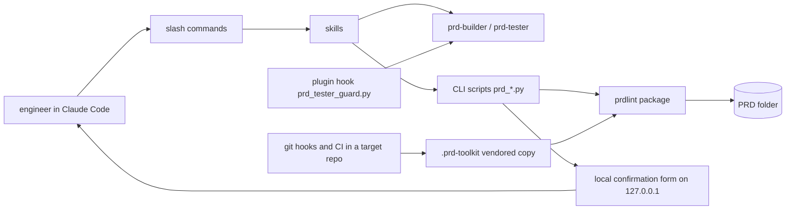

<!-- Format: references/prd-format.md, "prd.md sections". -->
<!-- The first approval goes through the prd-toolkit:authoring-prds skill (phase 7 gates); every later change and approval goes through prd-toolkit:changing-prds (step 5). -->

# prd-toolkit

## 1. Metadata & stack

- Language: Python 3.11 or later. Each CLI script (`prd-toolkit/scripts/prd_*.py`) is a uv script with an inline dependency header, run as `uv run --script <script>`, or through the launcher `prd-toolkit/scripts/prd` as `prd <command>` (the script's name without `prd_` and `.py`, `_` written `-`), which runs every script in one uv environment made from `scripts/requirements.txt`.
- Framework: a Claude Code plugin (skills, agents, slash commands, a plugin hook) in the `prdanvil` marketplace; script libraries pyyaml, sqlglot, openapi-spec-validator and markdown-it-py; pytest for the tests.
- Database: none.
- Hosting: the plugin is installed from the `prdanvil` marketplace into each user's Claude Code; a target repository runs a vendored copy of the scripts under `.prd-toolkit/` from its git hooks and CI, through the vendored launcher `.prd-toolkit/prd`.
- Repository: https://github.com/PRDAnvil/prd-toolkit, folder `prd-toolkit/`. This PRD covers `prd-toolkit/`; the repository root holds the `prdanvil` marketplace file (`.claude-plugin/marketplace.json`), the root README, the MIT LICENSE and this PRD. Until 2026-11-10 the toolkit lived in `ihistand/claude-plugins`; its history moved here with it.
- Not used: a network service, a database, a published Python package (target repositories run the vendored copy).
- Packaging: no build backend (`prd-toolkit/pyproject.toml` has `[tool.uv] package = false` and serves only the tests); the layout is `prd-toolkit/` with `scripts/` (the CLI scripts and the `prdlint` package), `skills/`, `agents/`, `commands/`, `hooks/`, `templates/` and `references/`; the entry points are the launcher `prd-toolkit/scripts/prd` (`prd <command>`) and the CLI scripts behind it, each of which also runs as `uv run --script prd-toolkit/scripts/prd_<name>.py`; the install command is `/plugin install prd-toolkit@prdanvil` after `/plugin marketplace add PRDAnvil/prd-toolkit`, and in a target repository `prd_hooks.py install docs/prd/<slug>` vendors the scripts.
- Not applicable: `contracts/openapi.yaml` — no HTTP API
- Not applicable: `contracts/schema.sql` — no database
- Not applicable: `contracts/events.md` — no events, jobs or queues
- Not applicable: `contracts/permissions.yaml` — no identities or roles
- Not applicable: `contracts/data-classification.yaml` — no stored personal data
- Not applicable: `contracts/dependencies/` — no third-party service is called; git and uv are tools on the runner (testing.md Harness), and the standards row runs the claude CLI through `npx`

## 2. Summary & goals

prd-toolkit keeps a living PRD folder in a repository and makes agents build, test and deploy
from it: a linter and trace checks for the folder, a black-box test agent, and skills that
author, adopt, change, build, deploy, handle errors in, publish and link PRDs.

Goals:

- Self-hosting: every area of the toolkit's own PRD (`adoption.md`) is `adopted`, with its characterization suite run in CI, before the plugin's version reaches 1.0.0.

Principles:

- The PRD is the authority: code implements what the PRD folder says and never defines behaviour it lacks.
- Spec-first, enforced: a behaviour change starts as a PRD change the owner approves, and the git hooks and CI refuse a commit that skips it.
- Black-box testable: every acceptance criterion has a test case a tester can write from the PRD alone, without reading the code.
- Error-Driven Development: every defect becomes an `errors.md` entry, and its fix starts from a test that fails first.
- The owner's word decides: approvals, error classes and human deploy steps are answered by the owner, never by an agent.
- Mechanical gates before judgement: lint, trace and the build checks run before any agent or person judges the work.
- The toolkit stays generic: it names no organization or platform; packs and wrapper plugins carry the specifics.

Getting started:

1. Install the plugin: `/plugin marketplace add PRDAnvil/prd-toolkit`, then `/plugin install prd-toolkit@prdanvil`.
2. Start a PRD with `/prd-toolkit:prd-new`, or bring an existing repository under one with `/prd-toolkit:prd-adopt`.
3. Install the hooks once per clone: `.prd-toolkit/prd hooks install docs/prd/<slug>`.
4. Change behaviour with `/prd-toolkit:prd-change`, then build it with `/prd-toolkit:prd-build`; report a bug with `/prd-toolkit:prd-error`.

Personas: an engineer working in a repository with Claude Code; the agents the toolkit
dispatches (`prd-builder`, `prd-tester`); a reviewer reading a published PRD page.

Out of scope: the target projects' own code.

## 3. Glossary

| Term | Meaning | Banned synonyms |
|---|---|---|
| PRD folder | `docs/prd/<slug>/` in a target repository: `prd.md` and the files the format reference names | spec folder |
| area | one feature file and its test-case file, bounded by the globs in its `adoption.md` row | none |
| requirement block | a `### UJ-nn`, `### FR-nnn` or `### NFR-nnn` heading and its field lines | story |
| finding | one line a check prints: `<file>:<line>: <rule>: <message>` | warning |
| rule | a named lint or trace check that produces findings | none |
| Boundary | the paths where the commit rule applies: the globs of the `adopted` rows | none |
| vendored copy | the scripts copied into a target repository's `.prd-toolkit/` by `prd_hooks.py install` | none |

## 4. Architecture

## 5. Standards registry

| Object (glob) | Linter command | Rules live in | Applies to | Decision |
|---|---|---|---|---|
| `prd-toolkit/**` | `npx -y @anthropic-ai/claude-code plugin validate ./prd-toolkit` | Claude Code's plugin manifest schema | code | enforced |

## 6. Skills registry

| Object or activity | Skill | Decision |
|---|---|---|
| a change to `prd-toolkit/skills/**` | superpowers:writing-skills | required |
| a change to the plugin's layout or manifests | superpowers-developing-for-claude-code:developing-claude-code-plugins | required |
| any code change | superpowers:test-driven-development | required |
| a bug or a failing test | superpowers:systematic-debugging | required |
| a claim that work is done | superpowers:verification-before-completion | required |
| planning a change | superpowers:writing-plans | required |
| a review of a change | code-review | recommended |

## 7. Contract types

| Type | Files (glob) | Validator |
|---|---|---|
| errors | `contracts/errors.yaml` | built-in |
| config | `contracts/config.yaml` | built-in |
| fixtures | `contracts/fixtures/**` | built-in |
| cli | `contracts/cli.yaml` | `uv run --with pyyaml python3 -c "import sys,yaml; sys.exit(0 if isinstance(yaml.safe_load(open('contracts/cli.yaml')), dict) else 1)"` |

`cli` holds one top-level key per CLI script (`prd_lint`, `prd_trace`, …): its arguments, its
output lines and its exit codes. A test case targets a script as `cli:<key>`.

## 8. Adoption map

See adoption.md.

## 9. Versioning

- Breaking for the API: a removed or renamed script or option, a changed output-line format, or a changed exit-code meaning.
- Breaking for the schema: a change that makes a PRD folder that linted clean fail lint, or drops a field or file the format accepted.
- Breaking for events: Not applicable: no events.
- Compatibility window: an old form keeps working, with a finding that names its replacement, for at least one minor version of the plugin.
- Migration rule: every format change has an upgrade note in the README changelog; a breaking one also has a lint finding that says how to fix the PRD.

## 10. Design & UI

Not applicable: command-line scripts and Claude Code skills; the published PRD page is a generated file, not a product interface.

## 11. Requirement index

| ID | Title | Status | File | Since |
|---|---|---|---|---|
| UJ-01 | An engineer lints a PRD folder and fixes what it reports | live | features/lint-cli.md | 1.0.0 |
| FR-001 | Lint a PRD folder and print its findings | verified | features/lint-cli.md |  |
| FR-002 | Name each finding's file from the working directory | live | features/lint-cli.md | 1.0.0 |
| FR-003 | List the rules | verified | features/lint-cli.md |  |
| FR-004 | Reject a bad command line | verified | features/lint-cli.md |  |
| FR-005 | Refuse a folder without prd.md | verified | features/lint-cli.md |  |
| FR-006 | Report an internal error without a traceback | verified | features/lint-cli.md |  |
| FR-007 | Sample T-ids for the dry run | verified | features/lint-cli.md |  |
| FR-008 | Mark a CI run for the rules | live | features/lint-cli.md | 1.0.0 |
| FR-009 | Write UTF-8 in any locale | live | features/lint-cli.md | 1.0.0 |
| FR-010 | Name a missing dependency | verified | features/lint-cli.md |  |
| FR-011 | Load the test-case files | verified | features/lint-cli.md |  |
| FR-012 | Load the contract YAML files | verified | features/lint-cli.md |  |
| FR-013 | List the packs | verified | features/lint-cli.md |  |
| FR-014 | Print the lint result as a JSON document | verified | features/lint-cli.md |  |
| FR-015 | Leave the PRD folder's root README out of the lint | verified | features/lint-cli.md |  |
| FR-016 | Report a Levels Timeout that is not a whole number of seconds | verified | features/lint-cli.md |  |
| FR-017 | Report an Environments Branch that git refuses | verified | features/lint-cli.md |  |
| FR-018 | Check a runbook Check's matches pattern | verified | features/lint-cli.md |  |
| NFR-019 | A test run leaves no cached uv environments behind | verified | nfr.md |  |
| FR-020 | Check the prd.md frontmatter | verified | features/lint-structure.md |  |
| FR-021 | Report a PRD language with no table | verified | features/lint-structure.md |  |
| FR-022 | Require prd.md's fourteen sections in order | verified | features/lint-structure.md |  |
| FR-023 | Require the mandatory files and account for the optional ones | live | features/lint-structure.md | 6.2.0 |
| FR-024 | Check section 8 and adoption.md | verified | features/lint-structure.md |  |
| FR-025 | Check testing.md's Harness slots | verified | features/lint-structure.md |  |
| FR-026 | Read prose without code and errors.md quotations | live | features/lint-structure.md | 6.2.0 |
| FR-027 | Report an unfilled placeholder | verified | features/lint-structure.md |  |
| FR-028 | Report a vague word without a number | verified | features/lint-structure.md |  |
| FR-029 | Report clarification markers left open once the PRD is in review | verified | features/lint-structure.md |  |
| FR-030 | Index every assumption marker | verified | features/lint-structure.md |  |
| FR-031 | Require no open question once the PRD is Approved | verified | features/lint-structure.md |  |
| FR-032 | Report a banned glossary synonym | verified | features/lint-structure.md |  |
| UJ-02 | A person or a program asks what a field or a lint finding means | verified | features/help.md |  |
| FR-033 | Print the index | verified | features/help.md |  |
| FR-034 | Print one entry or one rule as text | verified | features/help.md |  |
| FR-035 | Print the catalogue as one JSON document | verified | features/help.md |  |
| FR-036 | Refuse what it cannot answer | verified | features/help.md |  |
| FR-037 | The catalogue it reads, and what the shipped one covers | verified | features/help.md |  |
| FR-038 | Every lint rule carries a description | verified | features/help.md |  |
| FR-039 | A vendored copy answers the same | verified | features/help.md |  |
| UJ-03 | A person or a program asks what the PRD needs next | verified | features/status-next.md |  |
| FR-040 | The Next part comes first in the text report | verified | features/status-next.md |  |
| FR-041 | The Next items in the JSON document | verified | features/status-next.md |  |
| FR-042 | The order of the items, each listed once | verified | features/status-next.md |  |
| FR-043 | Broken: what must be fixed before anything else is trusted | verified | features/status-next.md |  |
| FR-044 | Waiting on you: the decisions only the owner can make | verified | features/status-next.md |  |
| FR-045 | Work: furthest along first | verified | features/status-next.md |  |
| FR-046 | Nothing waits | verified | features/status-next.md |  |
| FR-047 | A sentence ends with one full stop | verified | features/status-next.md |  |
| UJ-04 | An owner records where good practice comes from, and a builder is given the practices that apply | verified | features/practices.md |  |
| FR-048 | Read the sources and practices of practices.md | verified | features/practices.md |  |
| FR-049 | The lint rule practices | verified | features/practices.md |  |
| FR-050 | List the sources and practices | verified | features/practices.md |  |
| FR-051 | Print the record as one JSON document | verified | features/practices.md |  |
| FR-052 | Refuse what it cannot read | verified | features/practices.md |  |
| FR-053 | The launcher and a vendored copy answer the same | verified | features/practices.md |  |
| FR-054 | The next source and practice ID | verified | features/practices.md |  |
| FR-055 | The Practices part of the implement context pack | verified | features/practices.md |  |
| FR-056 | A pack's sources | verified | features/practices.md |  |
| UJ-05 | An owner with two adopted PRDs of one kind gets a pack from what they share | verified | features/pack-authoring.md |  |
| UJ-06 | An owner reading a card sees which area it is for and can open the thing it is about | verified | features/card-context.md |  |
| FR-057 | Compare two PRDs, as text | verified | features/pack-authoring.md |  |
| FR-058 | The comparison as JSON, and its refusals | verified | features/pack-authoring.md |  |
| FR-059 | Check a written pack against both PRDs | verified | features/pack-authoring.md |  |
| FR-060 | Lift a PRD onto the pack written from its own custom types | verified | features/pack-authoring.md |  |
| FR-061 | The launcher and a vendored copy answer the same | verified | features/pack-authoring.md |  |
| FR-062 | A gate's areas | verified | features/card-context.md |  |
| FR-063 | The URL: line of an error entry | verified | features/card-context.md |  |
| FR-064 | Write an entry's URL with prd error | verified | features/card-context.md |  |
| FR-065 | The url part of a Target: line | verified | features/card-context.md |  |
| FR-066 | A gate's URL | verified | features/card-context.md |  |
| FR-067 | Where the area and the URL show | verified | features/card-context.md |  |
| FR-068 | A standards row is never run on the vendored copy | verified | features/standards-run.md |  |
| FR-069 | The launcher runs on a system Python when uv finds one | verified | features/launcher.md |  |
| FR-070 | Install rewrites the toolkit's own hooks where core.hooksPath is set | verified | features/hook-shims.md |  |
| FR-071 | The inbox shows an error entry's card in the first worktree that holds it | verified | features/inbox-cards.md |  |
| FR-072 | The context pack prints an area's notes | verified | features/context-notes.md |  |
| FR-073 | The deploy and review eval scaffolds build their start states | verified | features/eval-scaffolds.md |  |
| FR-074 | The build check calls a changed file a tester's test only under a test root | verified | features/tester-paths.md |  |
| UJ-07 | Anyone with the repository sees whether the commit an entry names fixed it | verified | features/error-replay.md |  |
| FR-075 | The One test column of the Levels table | verified | features/error-replay.md |  |
| FR-076 | Replay an entry resolved with a T-id | verified | features/error-replay.md |  |
| FR-077 | Replay an entry resolved with a red run | verified | features/error-replay.md |  |
| FR-078 | What the replay prints and how it exits | verified | features/error-replay.md |  |
| FR-079 | The replay leaves nothing behind and writes nothing | verified | features/error-replay.md |  |
| FR-080 | Resolve a fix outside every adopted Boundary with a red run | verified | features/error-replay.md |  |
| FR-081 | Check a red run, and the older forms as before | verified | features/error-replay.md |  |

## 12. Assumptions index

| ID | Assumption | Status |
|---|---|---|

## 13. Open questions

None.

## 14. Changelog

| Version | Date | Change | IDs |
|---|---|---|---|
| 0.1.0 | 2026-11-03 | Draft started (adoption bootstrap) | none |
| 1.0.0 | 2026-11-03 | Approved; lint-cli area adopted; suite 29 pass, T-005.3 known-failing E-001, T-006.3 known-failing E-005, T-007.5 known-failing E-006, T-010.2 known-failing E-002, T-011.6 known-failing E-003, T-012.3 known-failing E-003, T-012.2 known-failing E-004; dry run T-004.1, T-007.1, T-007.5, T-011.1, T-011.2, 0 open questions, 0 dismissed by quote (an earlier dry run's 2 testing.md gaps were fixed) | UJ-01, FR-001, FR-002, FR-003, FR-004, FR-005, FR-006, FR-007, FR-008, FR-009, FR-010, FR-011, FR-012 |
| 1.0.1 | 2026-11-03 | §5 standards row runs `plugin validate` through `npx -y @anthropic-ai/claude-code`, so the generated CI job needs no claude CLI on the runner; §1 says so; no dry run (wording only) | none |
| 2.0.0 | 2026-11-03 | lint-cli for prd-toolkit 0.8.0: `warn` findings and an exit code that counts errors only, `--list-rules` with severities (a format change §9 calls breaking, accepted by the owner for 0.8.0), `--list-packs` (FR-013), and a one-line usage; the PRD_PLUGINS_FILE setting in contracts/config.yaml; testing.md defines the output keys, `runs`/`each_run` and in-process calls; dry run T-001.4, T-001.5, T-003.1, T-004.1, T-004.3, T-013.1, T-013.2, 0 open questions, 0 dismissed by quote (three earlier dry runs' 10 gaps fixed) | FR-001, AC-001.2, AC-001.4, AC-001.5, T-001.4, T-001.5, FR-003, AC-003.1, T-003.1, FR-004, AC-004.1, AC-004.3, T-004.1, T-004.3, FR-013, AC-013.1, AC-013.2, T-013.1, T-013.2 |
| 2.1.0 | 2026-11-03 | lint-cli FR-013: the vendored copy's `--list-packs` (its vendored packs with the sources pack-sources.json records, and its stderr note), as 0.8.0 ships it; AC-013.1 and AC-013.2 name the plugin's copy; testing.md gains the repo/vendored fixture and the stderr keys; dry run T-013.3, T-013.4, 0 open questions, 1 dismissed by quote (two earlier dry runs' 7 gaps fixed) | FR-013, AC-013.1, AC-013.2, AC-013.3, T-013.3, T-013.4 |
| 3.0.0 | 2026-11-03 | lint-cli for prd-toolkit 0.8.1: `--json` prints one `lint` JSON document (FR-014) and `--interface` prints the interface number; FR-001's line output is scoped to a run without `--json`; the one-line usage names both options (AC-004.1, a changed usage line T-004.1 and T-004.3 assert, so major); `prdlint/interface.py` joins the Boundary; testing.md gains the `stdout_json` keys; dry run T-004.1, T-004.3, T-014.1, T-014.2, T-014.3, T-014.4, T-014.5, T-014.6, T-014.7, 0 open questions, 1 dismissed by quote (an earlier dry run's 2 gaps fixed) | FR-001, AC-001.1, AC-001.2, AC-001.4, AC-001.5, FR-004, AC-004.1, T-004.1, T-004.3, FR-014, AC-014.1, AC-014.2, AC-014.3, AC-014.4, AC-014.5, AC-014.6, T-014.1, T-014.2, T-014.3, T-014.4, T-014.5, T-014.6, T-014.7 |
| 4.0.0 | 2026-11-04 | lint-cli FR-014: `--interface` wins over an unsupported `--json=<N>` (AC-014.4 no longer applies when `--interface` is given, so major; AC-014.5 says it), a gap the 0.8.1 build found; cli.yaml says it; dry run T-014.4, T-014.5, T-014.8, 0 open questions, 0 dismissed by quote | FR-014, AC-014.4, AC-014.5, T-014.8 |
| 5.0.0 | 2026-11-07 | lint-cli FR-006 for E-007: AC-006.3 widened so an entry named `<name>.yaml` in test-cases/ or under contracts/ outside contracts/fixtures/ that is not a regular file is a sufficiency finding at line 0 (`a .yaml entry that is not a file`), not an internal error (an input that exited 2 now exits 1, so major); regression tests T-006.4 and T-006.5 known-failing E-007; testing.md Tools on the runner names macOS or Linux with symbolic links and the pyproject.toml environment the Levels commands run in, two gaps the dry runs found; the STALE Source: line of FR-006 refreshed; dry run T-006.4, T-006.5, 0 open questions, 2 dismissed by quote (three earlier dry runs' 3 gaps fixed) | FR-006, AC-006.3, T-006.4, T-006.5 |
| 5.1.0 | 2026-11-07 | lint-cli FR-015 for prd-toolkit 0.8.4: lint reports no finding in the PRD folder's root README.md, which prd_block.py generates, and reads every other README.md as before (T-015.1, T-015.2, with the new fixture lint-cli/readme_markers in testing.md); §2 gains its Principles and Getting started parts; adoption.md maps 13 unmapped scripts in four not started rows (gates, change, judge, packs) and adds the 0.8.4 overview and README templates to the status row; dry run T-015.1, T-015.2, 0 open questions, 0 dismissed by quote (an earlier dry run's 1 gap fixed, 1 question dismissed by quote) | FR-015 |
| 5.2.0 | 2026-11-08 | lint-cli FR-016, FR-017, FR-018 for prd-toolkit 0.8.5: lint reports a testing.md Levels Timeout cell that is not a whole number of seconds of at least 1 (runbook-tests), an operations.md Environments Branch cell that git check-ref-format --branch refuses (runbook-env), and a runbook Check whose matches pattern does not compile or that holds both prints and matches (runbook-steps), with T-016.1, T-017.1, T-018.1 and T-018.2 on the fixture changes M2 to M5; testing.md runs the unit and integration levels with -n auto (pytest-xdist), a patch item; dry run T-016.1, T-017.1, T-018.1, T-018.2, 0 open questions, 0 dismissed by quote | FR-016, FR-017, FR-018 |
| 6.0.0 | 2026-11-09 | lint-cli FR-010 for prd-toolkit 0.8.5: prd_publish.py's dependency header gains the pinned diagram renderer mermaidx==0.11.3, so by the unchanged AC-010.2 its missing-package hint ends pip install pyyaml sqlglot openapi-spec-validator markdown-it-py mermaidx; T-010.2's expected stderr and note gain mermaidx (a changed expect, so major) and FR-010's Edge cases line names both added packages; adoption.md's publish row maps the new prdlint/diagrams.py, a patch item; dry run T-010.2, 0 open questions, 3 dismissed by quote | FR-010, T-010.2 |
| 6.1.0 | 2026-11-09 | NFR-019: a test run leaves no cached uv environments behind (test cache per worktree, E-008); dry run T-019.1, T-019.2, 0 open questions, 0 dismissed by quote | NFR-019, AC-019.1, AC-019.2, T-019.1, T-019.2 |
| 6.2.0 | 2026-11-10 | lint-structure area adopted (prdlint/rules/structure.py); suite 85 pass, T-020.14 known-failing E-012, T-022.4 known-failing E-009, T-022.5 known-failing E-014, T-024.7 known-failing E-016, T-025.9 known-failing E-013, T-025.10 known-failing E-014, T-027.9 known-failing E-011, T-028.7 known-failing E-010, T-028.8 known-failing E-010, T-029.11 known-failing E-011, T-030.10 known-failing E-011, T-031.3 known-failing E-015, T-032.5 known-failing E-011; testing.md gains the lint-structure/texts fixture and the stdout_not_contains and stdout_count_of_line keys; contracts/cli.yaml gains prd_lint.structure_findings; E-009 to E-016 recorded open; dry run T-020.14, T-022.4, T-022.5, T-024.7, T-025.9, T-025.10, T-027.9, T-028.7, T-028.8, T-029.11, T-030.10, T-031.3, T-032.5, 0 open questions, 0 dismissed by quote | FR-001, FR-002, FR-003, FR-004, FR-007, FR-008, FR-009, FR-013, FR-014, FR-020, FR-021, FR-022, FR-023, FR-024, FR-025, FR-026, FR-027, FR-028, FR-029, FR-030, FR-031, FR-032, AC-020.1, AC-020.2, AC-020.3, AC-020.4, AC-020.5, AC-020.6, AC-021.1, AC-021.2, AC-022.1, AC-022.2, AC-022.3, AC-022.4, AC-023.1, AC-023.2, AC-023.3, AC-023.4, AC-024.1, AC-024.2, AC-024.3, AC-024.4, AC-024.5, AC-024.6, AC-024.7, AC-024.8, AC-024.9, AC-025.1, AC-025.2, AC-025.3, AC-025.4, AC-025.5, AC-025.6, AC-025.7, AC-025.8, AC-025.9, AC-026.1, AC-026.2, AC-026.3, AC-027.1, AC-027.2, AC-027.3, AC-027.4, AC-027.5, AC-028.1, AC-028.2, AC-028.3, AC-028.4, AC-029.1, AC-029.2, AC-029.3, AC-029.4, AC-029.5, AC-030.1, AC-030.2, AC-030.3, AC-030.4, AC-030.5, AC-031.1, AC-031.2, AC-031.3, AC-032.1, AC-032.2, AC-032.3, AC-032.4, T-020.1, T-020.2, T-020.3, T-020.4, T-020.5, T-020.6, T-020.7, T-020.8, T-020.9, T-020.10, T-020.11, T-020.12, T-020.13, T-020.14, T-021.1, T-021.2, T-022.1, T-022.2, T-022.3, T-022.4, T-022.5, T-023.1, T-023.2, T-023.3, T-023.4, T-023.5, T-023.6, T-023.7, T-023.8, T-024.1, T-024.2, T-024.3, T-024.4, T-024.5, T-024.6, T-024.7, T-024.8, T-024.9, T-025.1, T-025.2, T-025.3, T-025.4, T-025.5, T-025.6, T-025.7, T-025.8, T-025.9, T-025.10, T-026.1, T-026.2, T-026.3, T-026.4, T-027.1, T-027.2, T-027.3, T-027.4, T-027.5, T-027.6, T-027.7, T-027.8, T-027.9, T-028.1, T-028.2, T-028.3, T-028.4, T-028.5, T-028.6, T-028.7, T-028.8, T-029.1, T-029.2, T-029.3, T-029.4, T-029.5, T-029.6, T-029.7, T-029.8, T-029.9, T-029.10, T-029.11, T-030.1, T-030.2, T-030.3, T-030.4, T-030.5, T-030.6, T-030.7, T-030.8, T-030.9, T-030.10, T-031.1, T-031.2, T-031.3, T-032.1, T-032.2, T-032.3, T-032.4, T-032.5 |
| 6.2.1 | 2026-11-10 | the toolkit moves to github.com/PRDAnvil/prd-toolkit and the prdanvil marketplace: section 1 Framework, Hosting, Repository and Packaging, section 2 Getting started, the operations.md production Environment and runbook steps 2 and 3, and the testing.md production row name the new home; the release area Boundary adds prd-toolkit/LICENSE; no dry run (wording only) | - |
| 6.2.2 | 2026-11-10 | §2 Getting started names the commands in full, /prd-toolkit:prd-new and the rest, as current Claude Code lists them; no dry run (wording only) | - |
| 6.2.3 | 2026-11-14 | for prd-toolkit 0.8.8: section 1 names the launcher prd-toolkit/scripts/prd beside the CLI scripts, and the vendored launcher the hooks and CI run; section 2 Getting started installs the hooks with .prd-toolkit/prd hooks install, and its Out of scope line drops the other plugins and the web/ docs site, which the repository has not held since the move; adoption.md maps the launcher, prd_dispatch.py and requirements.txt in trace-and-hooks and requirements-publish.txt in publish; no dry run (wording only) | - |
| 6.3.0 | 2026-11-14 | a new area help for prd-toolkit 0.8.9, written before its code: prd_help.py (prd help) prints a catalogue of every field of the PRD grammar and every lint rule as an index, one entry (--key), one rule (--rule) or one JSON document (--json), refuses an unknown key or rule, a usage error and a catalogue it cannot use with exit 2, reads the setting PRD_HELP_FILE, and answers the same from a vendored copy; every lint rule carries a description that lint never prints (FR-003 Edge cases); contracts/cli.yaml gains prd_help, contracts/config.yaml PRD_HELP_FILE, testing.md the fixture help/catalogue and the assertion keys stdout_json_at, stdout_json_keys_at and relations, adoption.md the adopted row help; dry run T-034.3, T-035.3, 0 open questions, 1 dismissed by quote (two earlier dry runs over ten T-ids: 4 gaps fixed) | UJ-02, FR-003, FR-033, FR-034, FR-035, FR-036, FR-037, FR-038, FR-039, AC-033.1, AC-034.1, AC-034.2, AC-035.1, AC-035.2, AC-035.3, AC-035.4, AC-036.1, AC-036.2, AC-036.3, AC-036.4, AC-036.5, AC-037.1, AC-037.2, AC-037.3, AC-038.1, AC-038.2, AC-038.3, AC-039.1, T-033.1, T-034.1, T-034.2, T-034.3, T-035.1, T-035.2, T-035.3, T-035.4, T-036.1, T-036.2, T-036.3, T-036.4, T-036.5, T-037.1, T-037.2, T-037.3, T-038.1, T-038.2, T-038.3, T-039.1 |
| 6.4.0 | 2026-11-15 | a new area status-next for prd-toolkit 0.8.10, written before its code: prd status starts with a part Next, the ordered list of what the PRD needs (lint and trace findings, stopped deploy runs, open errors, gates, questions, a draft, then deploy, verify, build and adopt work, or idle when nothing waits), each item one sentence with the command that does it, in the text report and first in the --json items with the keys part, id, text, kind, ids, area, command and waits_on; contracts/cli.yaml gains prd_status, testing.md the fixtures status-next/base, status-next/empty and status-next/files, a Setup steps section with the git variables its runs drop, the assertion keys next_part_lines and next_items_json and the rule that a test builds a citation-shaped text from parts, adoption.md the adopted row status-next; dry run T-042.2, T-043.3, T-043.1, T-043.4, T-043.7, T-044.3, T-044.4, T-045.1, T-047.1, 0 open questions, 1 dismissed by quote (two earlier dry runs over sixteen T-ids: 3 gaps fixed) | UJ-03, FR-040, FR-041, FR-042, FR-043, FR-044, FR-045, FR-046, FR-047, AC-040.1, AC-040.2, AC-040.3, AC-041.1, AC-041.2, AC-042.1, AC-042.2, AC-042.3, AC-043.1, AC-043.2, AC-043.3, AC-043.4, AC-044.1, AC-044.2, AC-044.3, AC-045.1, AC-045.2, AC-045.3, AC-045.4, AC-046.1, AC-046.2, AC-047.1, T-040.1, T-040.2, T-040.3, T-041.1, T-041.2, T-042.1, T-042.2, T-042.3, T-043.1, T-043.2, T-043.3, T-043.4, T-043.5, T-043.6, T-043.7, T-043.8, T-044.1, T-044.2, T-044.3, T-044.4, T-044.5, T-044.6, T-045.1, T-045.2, T-045.3, T-045.4, T-046.1, T-046.2, T-047.1 |
| 7.0.0 | 2026-11-15 | a new area practices for prd-toolkit 0.8.11, written before its code: practices.md in a PRD folder holds a Sources table and a Practices table (FR-048), the lint rule practices (the 41st) checks their IDs, Decisions, dates, Applies to, globs and the S-nn a section 5 row names (FR-049), prd practices lists them as text, by --paths or as one JSON document and refuses what it cannot read (FR-050 to FR-053), prd change ids next takes S and P (FR-054), the implement context pack of a PRD that holds practices.md gains a Practices part and a PRD without the file gets the pack it gets today (FR-055), and a pack manifest takes the optional sources list (FR-056); lint-cli T-003.1 and help T-033.1 gain the line for the rule practices (a changed expect, so major) and FR-003 Edge cases names it, help AC-037.4 and T-037.4 add the catalogue entries kind.S, kind.P, file.practices, table.sources and table.practices; contracts/cli.yaml gains prd_practices (with the finding messages of the rule practices), prd_change, prd_context and the five prd_help keys, testing.md the fixtures practices/repo and practices/texts, the practices Setup steps and the assertion keys pack_part_titles and pack_part_lines, adoption.md the adopted row practices; dry run T-055.6, T-049.5, T-049.10, T-049.12, T-051.4, T-052.2, T-052.4, T-053.2, T-054.2, T-054.4, T-055.4, T-056.2, 0 open questions, 1 dismissed by quote (three earlier dry runs over thirty-six T-ids: 3 gaps fixed) | UJ-04, FR-003, FR-033, FR-034, FR-035, FR-036, FR-037, FR-048, FR-049, FR-050, FR-051, FR-052, FR-053, FR-054, FR-055, FR-056, AC-037.4, AC-048.1, AC-048.2, AC-048.3, AC-049.1, AC-049.2, AC-049.3, AC-049.4, AC-049.5, AC-049.6, AC-049.7, AC-049.8, AC-049.9, AC-049.10, AC-050.1, AC-050.2, AC-051.1, AC-051.2, AC-051.3, AC-051.4, AC-052.1, AC-052.2, AC-052.3, AC-052.4, AC-052.5, AC-053.1, AC-053.2, AC-054.1, AC-054.2, AC-054.3, AC-055.1, AC-055.2, AC-055.3, AC-055.4, AC-055.5, AC-056.1, AC-056.2, AC-056.3, T-003.1, T-033.1, T-037.4, T-048.1, T-048.2, T-048.3, T-049.1, T-049.2, T-049.3, T-049.4, T-049.5, T-049.6, T-049.7, T-049.8, T-049.9, T-049.10, T-049.11, T-049.12, T-049.13, T-049.14, T-050.1, T-050.2, T-050.3, T-051.1, T-051.2, T-051.3, T-051.4, T-052.1, T-052.2, T-052.3, T-052.4, T-052.5, T-053.1, T-053.2, T-054.1, T-054.2, T-054.3, T-054.4, T-054.5, T-055.1, T-055.2, T-055.3, T-055.4, T-055.5, T-055.6, T-056.1, T-056.2, T-056.3 |
| 7.1.0 | 2026-11-15 | a pack written from two adopted PRDs (prd pack compare, prd pack check, prd change pack --lift) and the areas and a URL of every gate in prd gates list --json and the inbox card; standards rows are not run on the vendored copy, for E-025; dry run T-068.7, T-068.5, T-068.6, 0 open questions, 0 dismissed by quote (nine earlier dry runs over all 63 non-unit T-ids: 21 gaps fixed) | UJ-05, UJ-06, FR-057, FR-058, FR-059, FR-060, FR-061, FR-062, FR-063, FR-064, FR-065, FR-066, FR-067, FR-068, AC-057.1, AC-057.2, AC-057.3, AC-057.4, AC-057.5, AC-057.6, AC-057.7, AC-057.8, AC-058.1, AC-058.2, AC-058.3, AC-058.4, AC-059.1, AC-059.2, AC-059.3, AC-059.4, AC-059.5, AC-059.6, AC-060.1, AC-060.2, AC-060.3, AC-060.4, AC-060.5, AC-060.6, AC-060.7, AC-060.8, AC-061.1, AC-061.2, AC-062.1, AC-062.2, AC-062.3, AC-062.4, AC-063.1, AC-063.2, AC-063.3, AC-064.1, AC-064.2, AC-064.3, AC-064.4, AC-065.1, AC-065.2, AC-065.3, AC-066.1, AC-066.2, AC-066.3, AC-066.4, AC-067.1, AC-067.2, AC-067.3, AC-067.4, AC-067.5, AC-067.6, AC-068.1, AC-068.2, AC-068.3, AC-068.4, AC-068.5, T-057.1, T-057.2, T-057.3, T-057.4, T-057.5, T-057.6, T-057.7, T-057.8, T-058.1, T-058.2, T-058.3, T-058.4, T-058.5, T-059.1, T-059.2, T-059.3, T-059.4, T-059.5, T-059.6, T-059.7, T-060.1, T-060.2, T-060.3, T-060.4, T-060.5, T-060.6, T-060.7, T-060.8, T-060.9, T-060.10, T-061.1, T-061.2, T-062.1, T-062.2, T-062.3, T-062.4, T-062.5, T-063.1, T-063.2, T-063.3, T-064.1, T-064.2, T-064.3, T-064.4, T-065.1, T-065.2, T-065.3, T-066.1, T-066.2, T-066.3, T-066.4, T-067.1, T-067.2, T-067.3, T-067.4, T-067.5, T-067.6, T-068.1, T-068.2, T-068.3, T-068.4, T-068.5, T-068.6, T-068.7 |
| 7.2.0 | 2026-11-16 | pack-authoring gaps closed: the linter of a Linter cell with no backticked span, the Pack: line of a section 1 with no bullet, the line numbers of findings after a lift, the literal last word of the more-than-one-source refusal; dry run T-057.9, T-060.11, T-060.12, 0 open questions, 1 dismissed by quote | FR-057, FR-060, AC-057.6, AC-060.1, AC-060.7, AC-060.8, T-057.9, T-060.11, T-060.12 |
| 7.3.0 | 2026-11-16 | fixes for E-026 and E-027: the approval of a lift commits the vendored pack, and the check proves each validator runs from the pack folder; dry run T-059.8, T-060.13, 0 open questions, 0 dismissed by quote (four earlier dry runs: 7 gaps fixed, 1 dismissed by quote) | FR-057, FR-058, FR-059, FR-060, FR-061, AC-059.7, AC-060.9, T-059.8, T-060.13 |
| 8.0.0 | 2026-11-17 | fixes for E-020, E-021 and E-030: prd help refuses a catalogue file that is there and cannot be read with the reason cannot read (AC-036.3); a section 13 question is taken without the white space at its start and end, so a line ending in spaces gets no second full stop (AC-044.2, a changed result, so major); a lift refuses a pack that declares no contract type (AC-060.10, checked before AC-060.4), and AC-060.7 allows, beside the findings lint printed before a lift, the platform-word findings of the pack vocabulary; contracts/cli.yaml gains the refusal no_types, testing.md the steps NQ4, KE and KX; dry run T-036.6, T-044.7, T-060.14, T-060.15, 0 open questions, 1 dismissed by quote | FR-036, FR-044, FR-060, AC-036.3, AC-044.2, AC-060.1, AC-060.5, AC-060.7, AC-060.10, T-036.6, T-044.7, T-060.14, T-060.15 |
| 8.1.0 | 2026-11-17 | four new adopted areas written before their code, for E-022, E-023, E-024 and E-028: launcher (the prd launcher asks uv python find --system for a Python 3.11 or later and runs on the path it prints, else on >=3.11 as before), hook-shims (prd hooks install rewrites the toolkit own hooks where core.hooksPath is set, so check no longer calls them stale), inbox-cards (the decision inbox shows an error-class card once, in the first worktree group whose PRD folder holds the same entry, and its answer commits there alone) and context-notes (prd context --area prints the text a features file gives before its first block as a part Area notes before Requirements); contracts/cli.yaml gains prd_launcher and new keys of prd_hooks, prd_gates and prd_context, testing.md the fixtures launcher/texts, hook-shims/texts and context-notes/texts, Setup steps for the four areas and a cwd per run, adoption.md the four rows, the launcher moving out of trace-and-hooks; dry run T-069.1, T-069.2, T-069.3, T-070.1, T-070.2, T-070.3, T-071.1, T-071.2, T-071.3, T-071.4, T-071.5, T-072.1, T-072.2, 0 open questions, 1 dismissed by quote (four earlier rounds over the same T-ids: 16 gaps fixed) | FR-055, FR-062, FR-066, FR-067, FR-068, FR-069, FR-070, FR-071, FR-072, AC-069.1, AC-069.2, AC-070.1, AC-070.2, AC-070.3, AC-071.1, AC-071.2, AC-071.3, AC-072.1, AC-072.2, T-069.1, T-069.2, T-069.3, T-070.1, T-070.2, T-070.3, T-071.1, T-071.2, T-071.3, T-071.4, T-071.5, T-072.1, T-072.2 |
| 8.2.0 | 2026-11-18 | a new adopted area written before its code, for E-019: eval-scaffolds (deploy_repo.py commits every file install left untracked, in one dated commit after Vendor the PRD toolkit, so the six deploy scaffolds end with a clean tree; the review-edits-nothing scaffold expects the index row record writes, with an empty Since); contracts/cli.yaml gains eval_scaffolds; testing.md Tools on the runner names bash and the network need of T-073.1 to T-073.3; dry run T-073.1, T-073.2, T-073.3, T-073.4, 0 open questions, 0 dismissed by quote (two earlier rounds over the same T-ids: 7 gaps fixed) | FR-073, AC-073.1, AC-073.2, AC-073.3, T-073.1, T-073.2, T-073.3, T-073.4 |
| 8.2.1 | 2026-11-18 | eval-scaffolds, found by the FR-073 build for E-019: the area text names a third file the build edits, error_repo.py, which builds on deploy_repo.py and makes its CLAUDE.md commit only when prd_block.py left something to commit; no AC, test case or contract changes; no dry run (no new or revised T-id) | FR-073 |
| 8.3.0 | 2026-11-18 | a new adopted area written before its code, for E-031: tester-paths (the build check calls a changed file a tester test only when it lies under a test root of testing.md, tests when it names none, so a file outside the roots that holds a citation text can be changed by a build); contracts/cli.yaml gains prd_build_check, testing.md the tester-paths Setup steps, adoption.md the row; dry run T-074.1, T-074.2, T-074.3, T-074.4, T-074.5, 0 open questions, 0 dismissed by quote (three rounds: 3 gaps in the Setup steps text fixed after the first two, the third over T-074.2 and T-074.5 clean) | FR-074, AC-074.1, AC-074.2, T-074.1, T-074.2, T-074.3, T-074.4, T-074.5 |
| 8.3.1 | 2026-11-18 | test case corrected for E-019: T-073.3 reads the commit dates in git raw form (seconds and offset), which every git version prints alike, where the ISO form it used prints offset zero as +00:00 or as Z by version; AC-073.2 and the code are unchanged; FR-073 returns to approved; dry run T-073.3, 0 open questions, 0 dismissed by quote | FR-073, T-073.3 |
| 8.4.0 | 2026-11-20 | a new adopted area written before its code, for prd-toolkit 0.8.14: error-replay (prd error replay runs an entry test on the commit before its fix, where it must fail, and on the fix, where it must pass, each run in a temporary git worktree it removes, and prints that the proof holds, a skip with its reason, or each finding; a fourth Resolution form, a fix with a red run in place of a T-id for code no adopted area covers, which prd error resolve --red-run writes only when its replay holds and prd error check reads; the optional One test column of testing.md Levels, the command that runs one test, which the rule runbook-tests checks); contracts/cli.yaml gains the replay, resolve --red-run and check items under prd_error, testing.md the fixture error-replay/files, the error-replay Setup steps and a Waits exception for the interrupt case, adoption.md the row; format: One test column (prd-toolkit 0.8.14); dry run T-075.1, T-075.2, T-075.3, T-075.4, T-075.5, T-076.1, T-076.2, T-076.3, T-076.4, T-076.5, T-076.6, T-076.7, T-076.8, T-076.9, T-077.1, T-077.2, T-077.3, T-077.4, T-077.5, T-078.1, T-078.2, T-078.3, T-078.4, T-078.5, T-078.6, T-078.7, T-078.8, T-078.9, T-078.10, T-078.11, T-078.12, T-078.13, T-078.14, T-078.15, T-078.16, T-078.17, T-078.18, T-078.19, T-078.20, T-078.21, T-078.22, T-079.1, T-079.2, T-079.3, T-079.4, T-079.5, T-080.1, T-080.2, T-080.3, T-080.4, T-080.5, T-080.6, T-080.7, T-080.8, T-080.9, T-080.10, T-080.11, T-080.12, T-080.13, T-080.14, T-080.15, T-081.1, T-081.2, T-081.3, T-081.4, T-081.5, T-081.6, T-081.7, T-081.8, T-081.9, T-081.10, T-081.11, T-081.12, T-081.13, 0 open questions, 0 dismissed by quote (two rounds: 4 gaps in testing.md, AC-081.3, AC-081.4 and two cases fixed after the first, over all 74; the second, over the 13 T-ids they touch, clean) | UJ-07, FR-063, FR-064, FR-065, FR-075, FR-076, FR-077, FR-078, FR-079, FR-080, FR-081, AC-075.1, AC-075.2, AC-075.3, AC-075.4, AC-076.1, AC-076.2, AC-076.3, AC-076.4, AC-076.5, AC-077.1, AC-077.2, AC-077.3, AC-078.1, AC-078.2, AC-078.3, AC-078.4, AC-078.5, AC-078.6, AC-078.7, AC-078.8, AC-078.9, AC-078.10, AC-078.11, AC-078.12, AC-078.13, AC-079.1, AC-079.2, AC-079.3, AC-079.4, AC-079.5, AC-080.1, AC-080.2, AC-080.3, AC-080.4, AC-080.5, AC-080.6, AC-080.7, AC-080.8, AC-080.9, AC-080.10, AC-081.1, AC-081.2, AC-081.3, AC-081.4, T-075.1, T-075.2, T-075.3, T-075.4, T-075.5, T-076.1, T-076.2, T-076.3, T-076.4, T-076.5, T-076.6, T-076.7, T-076.8, T-076.9, T-077.1, T-077.2, T-077.3, T-077.4, T-077.5, T-078.1, T-078.2, T-078.3, T-078.4, T-078.5, T-078.6, T-078.7, T-078.8, T-078.9, T-078.10, T-078.11, T-078.12, T-078.13, T-078.14, T-078.15, T-078.16, T-078.17, T-078.18, T-078.19, T-078.20, T-078.21, T-078.22, T-079.1, T-079.2, T-079.3, T-079.4, T-079.5, T-080.1, T-080.2, T-080.3, T-080.4, T-080.5, T-080.6, T-080.7, T-080.8, T-080.9, T-080.10, T-080.11, T-080.12, T-080.13, T-080.14, T-080.15, T-081.1, T-081.2, T-081.3, T-081.4, T-081.5, T-081.6, T-081.7, T-081.8, T-081.9, T-081.10, T-081.11, T-081.12, T-081.13 |
| 8.5.0 | 2026-11-20 | regression test and fix route for E-033: every git command the replay runs leaves out the variables git rev-parse --local-env-vars lists (T-079.6 known-failing E-033); a One test program that cannot start is a finding of its own, in text and --json and as a resolve --red-run refusal (AC-078.14, FR-076 edge case); the help catalogue kind.E names the red-run form, and references/help.yaml joins the files the build edits (AC-081.5); dry run T-078.23, T-078.24, T-079.6, T-080.16, T-081.14, 0 open questions, 0 dismissed by quote (two rounds: 3 gaps, in T-079.6's symptom and the command-splitting sentence of testing.md, fixed after the first; the second clean) | FR-063, FR-064, FR-065, FR-075, FR-076, FR-077, FR-078, FR-079, FR-080, FR-081, AC-078.11, AC-078.14, AC-081.5, T-078.23, T-078.24, T-079.6, T-080.16, T-081.14 |
| 9.0.0 | 2026-11-21 | regression test and fix route for E-035: the replay makes each run in a clone of its own (git clone --shared --no-checkout of the repository, then a detached checkout of the commit under test) in place of a linked worktree, so it writes nothing in the repository git folder and holds where that folder cannot take a new worktree (AC-079.6, T-079.7 known-failing E-035); AC-076.1, AC-077.1 and AC-079.4, the definitions, the FR-076 and FR-077 Edge cases, the FR-079 Flow and Edge cases and the contracts/cli.yaml exit 130 say clone; T-077.6 checks that a clone is a git checkout; testing.md gains the steps RNW and RIW; the notes of T-076.7, T-078.23, T-078.24 and T-080.16 say clone; dry run T-076.7, T-077.6, T-078.23, T-078.24, T-079.7, T-080.16, 0 open questions, 0 dismissed by quote | FR-063, FR-064, FR-065, FR-075, FR-076, FR-077, FR-078, FR-079, FR-080, FR-081, AC-076.1, AC-077.1, AC-079.4, AC-079.6, T-076.7, T-077.6, T-078.23, T-078.24, T-079.7, T-080.16 |
